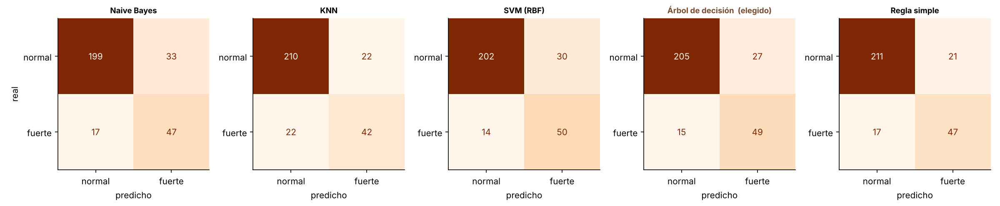
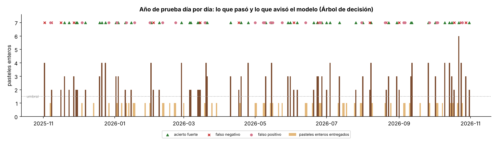
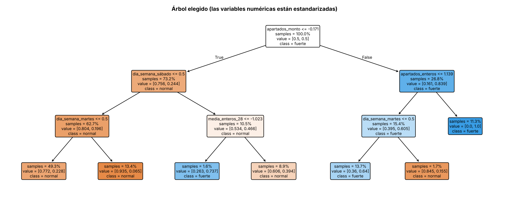

# ¿Viene un día fuerte? Modelado predictivo para Salomé

| | |
|---|---|
| Materia | Analítica de Datos (IAD-2403), Unidad 3 · Proyecto práctico integrador |
| Profesor | Armando Gallardo Heredia |
| Equipo | Jarom Cortes Pérez · Carlos Antonio Vogel Romero |
| Fecha | 30 de noviembre de 2026 · Ingeniería en Inteligencia Artificial, TecNM Campus Colima |
| Notebook | `Final_Salome_Modelado_Predictivo.ipynb` (incluye los avances 1 y 2) |

## 1. El problema

Salomé tiene una postrería casera en Villa de Álvarez y trabaja sola. Su cheesecake reposa una noche y el queso crema se compra antes, así que la cantidad de pasteles enteros de un día se decide dos días antes: el jueves decide el sábado. Hoy lo hace a ojo. Si se queda corta rechaza pedidos (unos $500 cada uno); si prepara de más le sobra una base (unos $150 en insumos que vende en rebanadas). En un día normal le basta con un pastel entero listo; el problema son los días que piden dos o más.

Variable objetivo: `dia_fuerte` = 1 si ese día se entregan 2 o más pasteles enteros. Es una clasificación binaria. Elegimos clasificación y no regresión porque la decisión es de sí o no (¿hago una base extra?) y porque el conteo diario es 0, 1 o 2 en nueve de cada diez días.

## 2. Datos

- Archivo de pedidos: 2,627 renglones crudos (13 columnas) del 5 de febrero de 2020 al 31 de octubre de 2026 (el historial de E0 y E1 más la última semana de octubre, que entró por la API de ingesta). Cerca de 6% traía errores de captura: 13 duplicados, nombres y canales escritos distinto, unidades en texto, fechas en otro formato, 14 valores nulos de precio o unidades, 5 unidades con un cero de más y 10 totales mal tecleados. Cada error se corrigió con una regla del negocio (por ejemplo, unidades = total / precio), no con la media. Quedaron 2,614 renglones, 1,963 pedidos y 711 clientes.
- Tabla de modelado: una fila por día abierto de 2022 a octubre de 2026, 1,442 días, con 10 variables explicativas que se conocen dos días antes: 6 numéricas (pasteles, pedidos, pesos y otras piezas ya apartados para ese día; pasteles del mismo día de la semana anterior; promedio de los últimos 28 días), 3 categóricas (día de la semana, mes, tipo de fecha) y 1 binaria (quincena). 22% de los días son fuertes.

Hallazgos del EDA. Las variables numéricas no son normales (Shapiro-Wilk, p < 0.001) y tienen colas largas. Lo apartado dos días antes es lo que más separa las clases (Spearman 0.62 con el objetivo): con nada apartado, solo 8% de los días terminan siendo fuertes; con 1 pastel, 30%; con 2 o más, todos. El sábado es el día más fuerte (37%) y diciembre el mes más fuerte (32%). La quincena no se relaciona con el objetivo (χ², p = 0.83), ni la historia de la semana anterior (0.04). Tres variables de apartados son casi redundantes entre sí (0.99). Los atípicos de apartados se conservaron porque entre 96% y 100% son días fuertes reales; los 82 nulos de la semana anterior (5.7%, semanas de vacaciones) se imputaron.

## 3. Metodología

1. Preprocesamiento en un `ColumnTransformer` dentro de cada `Pipeline`: mediana más indicador de faltante y `StandardScaler` para las numéricas; moda y One-Hot para las categóricas (30 columnas en total). Se ajusta solo con entrenamiento.
2. Partición cronológica: entrenamiento del 1 de enero de 2022 al 31 de octubre de 2025 (1,146 días, 79.5%) y prueba el año siguiente completo (296 días, 20.5%). Revolver al azar dejaría que el modelo aprenda del futuro. Dentro del entrenamiento, validación cruzada temporal con `TimeSeriesSplit` de 5 bloques.
3. Modelos de la Unidad 3: Naive Bayes gaussiano, KNN, SVM con kernel RBF y árbol de decisión. Referencias: la clase mayoritaria y la regla simple que Salomé puede aplicar de memoria ("un pastel apartado de viernes a domingo, o dos en cualquier día").
4. Criterio: F2, que pesa el recall el doble que la precisión, porque dejar pasar un día fuerte cuesta más que una falsa alarma. Se fijó antes de ver la prueba.
5. Optimización: `GridSearchCV` con la validación temporal (5 a 48 combinaciones por modelo), incluyendo `class_weight="balanced"` en SVM y árbol, y al menos 5 días por hoja en el árbol. El modelo se elige con la validación; la prueba solo confirma.

## 4. Comparativa de modelos

Primera vuelta con hiperparámetros por omisión (Avance 2) y versión optimizada, evaluadas en el año de prueba:

| Modelo | F2 por omisión | Hiperparámetros optimizados | F2 en CV | Accuracy | Precision | Recall | F1 | F2 | AUC |
|---|---|---|---|---|---|---|---|---|---|
| Naive Bayes | 0.699 | var_smoothing = 1e-6 | 0.676 | 0.831 | 0.588 | 0.734 | 0.653 | 0.699 | 0.851 |
| KNN | 0.669 | k = 3, distancia ponderada | 0.607 | 0.851 | 0.656 | 0.656 | 0.656 | 0.656 | 0.828 |
| SVM (RBF) | 0.646 | C = 0.3, γ = 0.01, balanceado | 0.686 | 0.851 | 0.625 | **0.781** | 0.694 | **0.744** | **0.878** |
| **Árbol de decisión (elegido)** | 0.650 | profundidad 3, hoja ≥ 5, balanceado | **0.694** | 0.858 | 0.645 | 0.766 | 0.700 | 0.738 | 0.869 |
| Regla simple | — | — | 0.664 | 0.872 | 0.691 | 0.734 | 0.712 | 0.725 | — |
| Clase mayoritaria | — | — | 0.000 | 0.784 | 0.000 | 0.000 | 0.000 | 0.000 | — |

Tres lecturas. Primero, la exactitud engaña: la clase mayoritaria acierta 78% sin avisar un solo día fuerte, y con valores por omisión el SVM llegó a 0.91 de exactitud y precisión perfecta porque solo marcaba los 38 días que ya tenían dos pasteles apartados. Segundo, la optimización subió casi 0.10 el F2 del SVM y del árbol, sobre todo por `class_weight="balanced"`; el árbol además pasó de memorizar (199 hojas, F1 de 0.99 en entrenamiento y 0.64 en prueba) a 7 hojas. KNN empeoró un poco en prueba aunque mejoró en validación (k = 3 se ajustó de más a los bloques). Tercero, el árbol ganó en validación y en prueba queda a un día del SVM (15 días fuertes perdidos contra 14); lo elegimos porque la decisión se tomó antes de ver la prueba y porque se puede explicar a Salomé. La primera versión que se desplegó en E3 (13 variables, árbol de profundidad 2, F2 de 0.74 en el mismo año de prueba) llega a casi la misma regla: un pedido apartado basta, sin la excepción del martes.

## 5. El modelo elegido y sus errores

Leído en unidades reales, el árbol dice: si no hay nada apartado para ese día, es normal; si ya hay 2 pasteles apartados o más, es fuerte; si hay 1, es fuerte salvo que sea martes. La importancia por permutación lo confirma: revolver lo apartado hace caer el F2 en 0.46, y cualquier otra variable lo mueve menos de 0.02. Las fechas especiales importan, pero su efecto llega por los apartados (en las fechas fuertes hay 2.4 pasteles apartados en promedio contra 0.4 en un día normal).

En el año de prueba acertó 49 de 64 días fuertes y 205 de 232 normales. Falsos negativos (15): 14 llegaron sin nada apartado dos días antes y se llenaron a última hora, 10 con exactamente 2 pasteles. Con la información del jueves no se distinguen de un sábado normal. Falsos positivos (27): todos tenían 1 pastel apartado y se quedaron en 1, la mayoría en fin de semana (21). Es el error barato.

| Método | Días fuertes perdidos | Falsas alarmas | Costo estimado del año | Ahorro contra no anticipar |
|---|---|---|---|---|
| Sin anticipar (siempre 1 pastel) | 64 | 0 | $32,000 | — |
| Regla simple | 17 | 21 | $11,650 | $20,350 |
| SVM (RBF) | 14 | 30 | $11,500 | $20,500 |
| **Árbol de decisión** | 15 | 27 | $11,550 | $20,450 |

## 6. Conclusiones y decisiones

1. Sí se puede anticipar un día fuerte dos días antes en tres de cada cuatro casos (recall 0.77), y hacerlo vale unos $20,000 al año contra no anticipar.
2. Regla de producción para Salomé: dos días antes, si ya hay al menos un pastel entero apartado y no es martes, preparar una base extra; con dos apartados, el día es fuerte sin duda.
3. Un modelo complejo apenas mejora una regla simple. La regla de referencia rinde casi igual que el mejor modelo (diferencia de unos $100 al año). El valor del modelo está en confirmarla con datos, ajustar sus bordes (un apartado para miércoles o jueves también cuenta; para martes, no) y dar una probabilidad que el tablero del proyecto en la nube ya muestra.
4. Para mejorar hace falta otra información, no otro algoritmo. Casi todos los días que se escapan llegaron sin apartado. Recomendamos ofrecer un pequeño descuento por apartar con tres días o más, y anotar las consultas que no se cierran ("¿tienes para el sábado?"), que serían la variable que hoy no existe.

### Límites

El modelo se debe reentrenar y evaluar de nuevo cada temporada, conforme entren pedidos nuevos. Los costos de $500 y $150 son aproximados. El árbol depende casi de una sola variable: si Salomé cambia su forma de tomar pedidos, hay que reentrenar.
