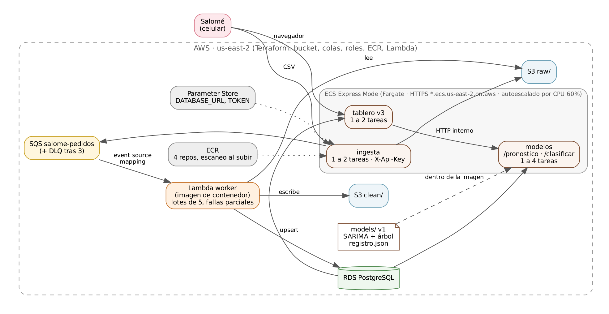

# Cómputo en la Nube (IAD-2408) · Guía de revisión

Proyecto integrador **DATA STARTUP · DulceDato**, la plataforma que le dice a la postrería Salomé cuánto hornear cada día.
Equipo: Jarom Cortes Pérez (Cloud Lead) · Carlos Antonio Vogel Romero (Data Lead).

Esta página reúne en un solo lugar todo lo que corresponde a Cómputo en la Nube. El código vive en las carpetas de la raíz del repositorio; aquí están los enlaces directos a cada pieza.

## 1. Entregables

| Entrega | Documento | Versión entregada |
|---|---|---|
| E0 · Propuesta | [E0-propuesta.pdf](../docs/E0-propuesta.pdf) | etiqueta [`e0`](https://github.com/Vogelito09-lab/data-startup-postreria/tree/e0) |
| E1 · Dashboard empresarial | [E1-dashboard.pdf](../docs/E1-dashboard.pdf) | etiqueta [`e1`](https://github.com/Vogelito09-lab/data-startup-postreria/tree/e1) |
| E2 · Cimientos en la nube | [E2-cimientos.pdf](../docs/E2-cimientos.pdf) | etiqueta [`e2`](https://github.com/Vogelito09-lab/data-startup-postreria/tree/e2) |
| E3 · Inteligencia en producción | [E3-produccion.pdf](../docs/E3-produccion.pdf) | etiqueta [`e3`](https://github.com/Vogelito09-lab/data-startup-postreria/tree/e3) |
| Speech del proyecto | [Diapositivas](speech/DulceDato_presentacion.pdf) | esta carpeta |

Cada PDF incluye sus capturas reales de AWS; las imágenes originales están en [docs/img/evidencia/](../docs/img/evidencia/).

## 2. Cómo funciona (arquitectura)



```
CSV de pedidos ─► API de ingesta (ECS) ─► S3 raw/ ─► cola SQS ─► Lambda (limpieza) ─► S3 clean/ + PostgreSQL (RDS)
                                                        └─► cola de errores tras 3 intentos          │
                                   tablero (ECS) ◄── API de modelos (ECS: SARIMA + árbol de decisión) ◄┘
```

Región `us-east-2` (Ohio). Infraestructura con Terraform; servicios en contenedores Docker sobre Amazon ECS Express Mode.

## 3. Dónde está cada requisito

### E1 · Almacenamiento y tablero en la nube (tema 2.4)

| Requisito | Dónde verlo |
|---|---|
| Data lake con zonas `raw/` y `clean/` | [E1, sección 7](../docs/E1-dashboard.pdf) · captura `e1_bucket.png` |
| Tablero que lee de `clean/` en la nube | [services/tablero/fuente.py](../services/tablero/fuente.py) · [app.py](../services/tablero/app.py) |
| Credenciales fuera del código | [.gitignore](../.gitignore) · el servidor usa un rol de IAM, sin llaves |
| Mínimo privilegio | [infra/iam/politica-tablero.json](../infra/iam/politica-tablero.json) |
| Acceso seguro y alerta de presupuesto | capturas `e0_raiz_mfa.png`, `e0_identity_center.png`, `e0_budgets.png` |

### E2 · Cimientos (temas 2.1 a 2.5)

| Requisito | Dónde verlo |
|---|---|
| Diagrama de arquitectura | [docs/arquitectura_e2.dot](../docs/arquitectura_e2.dot) · [imagen](../docs/img/e2_0_arquitectura.png) |
| Base de datos con esquema | [infra/sql/esquema.sql](../infra/sql/esquema.sql) · [usuarios.sql](../infra/sql/usuarios.sql) |
| Microservicio de ingesta con OpenAPI | [services/ingesta/app.py](../services/ingesta/app.py) · [openapi-ingesta.json](../docs/openapi-ingesta.json) |
| Cola, worker, reintentos y cola de errores | [services/worker/worker.py](../services/worker/worker.py) · [infra/aws/crear_infra_e2.sh](../infra/aws/crear_infra_e2.sh) |
| Rol de servicio de mínimo privilegio | [infra/iam/](../infra/iam/) · [probar_privilegios.sh](../infra/aws/probar_privilegios.sh) (16 de 16) |
| Limpieza automatizada con pruebas | [services/worker/limpieza.py](../services/worker/limpieza.py) · [tests/test_limpieza.py](../tests/test_limpieza.py) |
| Flujo de punta a punta | [tests/demo_punta_a_punta.sh](../tests/demo_punta_a_punta.sh) · captura `e2_demo_ec2.png` |
| Instalación en la EC2 | [infra/ec2/](../infra/ec2/) (Session Manager y systemd) |

### E3 · Producción (temas 3.1 a 3.6)

| Requisito | Dónde verlo |
|---|---|
| Contenedores (un Dockerfile por servicio, multi-stage) | [ingesta](../services/ingesta/Dockerfile) · [modelos](../services/modelos/Dockerfile) · [tablero](../services/tablero/Dockerfile) · [worker](../services/worker/Dockerfile) |
| Todo con un comando | [docker-compose.yml](../docker-compose.yml) (7 servicios) · captura `e3_compose.png` |
| Despliegue administrado con URL pública | [infra/aws/desplegar_ecs.py](../infra/aws/desplegar_ecs.py) · [subir_imagenes.sh](../infra/aws/subir_imagenes.sh) · captura `e3_ecs.png` |
| Orquestación con Kubernetes y HPA | [k8s/](../k8s/) · captura `e3_hpa.png` (de 1 a 5 réplicas) |
| Serverless | [services/worker/lambda_handler.py](../services/worker/lambda_handler.py) · [Dockerfile.lambda](../services/worker/Dockerfile.lambda) · captura `e3_lambda_logs.png` |
| Autoescalado y prueba de carga | [tests/locustfile.py](../tests/locustfile.py) · resultados en [docs/carga/](../docs/carga/) · captura `e3_locust_ecs.png` |
| Infraestructura como código | [infra/terraform/](../infra/terraform/) · captura `e3_terraform.png` (44 recursos destruidos y recreados) |
| Cómputo para entrenar y modelos versionados | [scripts/entrenar_e3.py](../scripts/entrenar_e3.py) · [models/registro.json](../models/registro.json) |
| API de modelos | [services/modelos/app.py](../services/modelos/app.py) · [openapi-modelos.json](../docs/openapi-modelos.json) |

## 4. Resultados

| Indicador | Resultado |
|---|---|
| Error del pronóstico contra copiar la semana pasada | 23% menor |
| Días fuertes avisados con dos días de anticipación | 50 de 64 |
| Del archivo subido al tablero actualizado | menos de 1 minuto |
| Autoescalado en Kubernetes con 50 usuarios | de 1 a 5 réplicas |
| Infraestructura recreada con Terraform | 44 recursos |
| Pruebas automáticas | 43 pasan, 1 requiere PostgreSQL de prueba |

## 5. Cómo correrlo

```bash
pip install -r requirements-dev.txt
python -m pytest -q tests/          # pruebas
docker compose up --build           # todo el sistema en local: tablero en localhost:8501
bash k8s/levantar_kind.sh           # Kubernetes local con autoescalado
```

Para desplegar en AWS, el paso a paso está en el [README principal](../README.md#desplegar-en-aws-e3). Entre revisiones los servicios de ECS, la EC2 y la base de datos se apagan para no generar costos.
