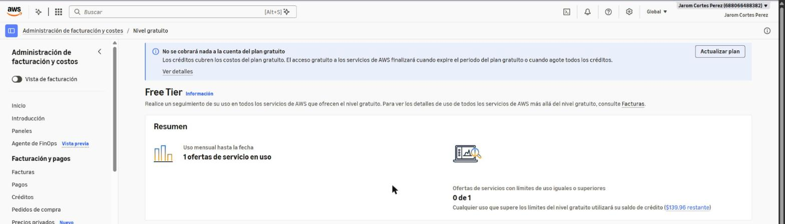
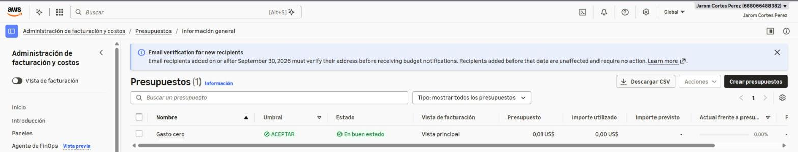
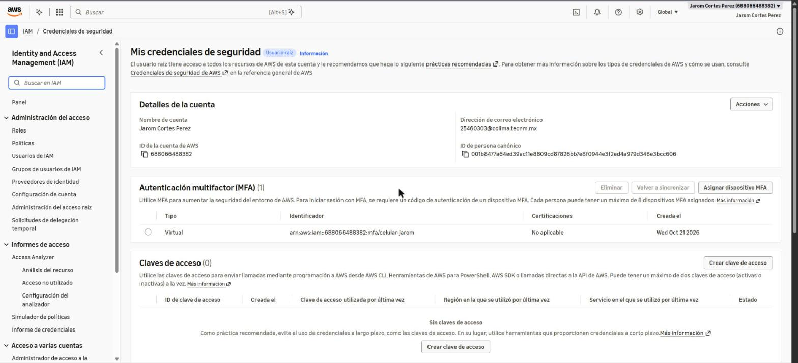
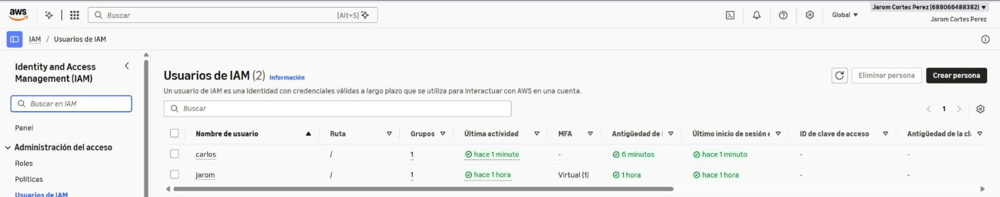
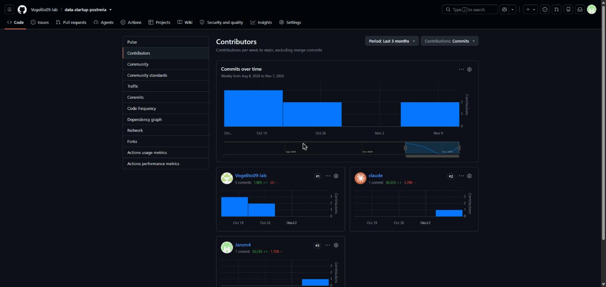

# E0 · Propuesta: DulceDato Analytics para Salomé

Proyecto integrador DATA STARTUP · Cómputo en la Nube (IAD-2408) × Analítica de Datos (IAD-2403) · TecNM Campus Colima

| | |
|---|---|
| Integrantes | Jarom Cortes Pérez (Cloud Lead) · Carlos Antonio Vogel Romero (Data Lead) |
| Cliente | Salomé, postrería casera por pedido en Villa de Álvarez, Colima |
| Proveedor de nube | AWS, región us-east-2 (Ohio), cuenta con el Plan gratuito |
| Repositorio | https://github.com/Vogelito09-lab/data-startup-postreria · etiqueta `e0` |
| Versión | Corregida, 12 de noviembre de 2026 (sustituye la entregada en octubre) |

## 1. En un minuto

Salomé hace postres en su cocina y los vende por WhatsApp, Instagram y Facebook. Trabaja sola. Cada tarde decide cuántos cheesecakes, pays y pasteles preparar para el día siguiente sin saber cuántos pedidos van a llegar. Si se pasa, tira rebanadas; si se queda corta, rechaza pedidos el sábado. DulceDato le da cada mañana un número por producto: cuántas piezas preparar para los próximos días, calculado con su propio historial de pedidos.

## 2. El problema

En un negocio por pedido la venta no se ve en un mostrador. Llega como mensajes, más de un tercio de noche, y uno de cada tres pedidos es para el mismo día. Varios postres se tienen que preparar con anticipación (el cheesecake reposa toda la noche), así que la producción se decide antes de conocer la demanda.

Eso le cuesta de dos formas. Entre semana prepara de más y lo que no se vende dura dos o tres días refrigerado. En fin de semana y en fechas como San Valentín o el 10 de mayo llega a su tope de horno y de refrigerador, y los pedidos que ya no caben se pierden sin quedar anotados en ningún lado. Además, como sus pedidos están repartidos en tres chats, no sabe con números qué días, horas y productos le dejan más.

## 3. Entrevista

Entrevista a la dueña, que también es la única persona que produce. 21 de octubre de 2026, 20 minutos.

| # | Pregunta | Respuesta (resumen fiel) |
|---|---|---|
| 1 | ¿Cómo decides cuánto preparar de cada postre? | "Veo lo que ya tengo apartado en WhatsApp e Instagram y lo que vendí la semana pasada. Lo decido la tarde anterior porque el cheesecake tiene que reposar toda la noche. Estoy yo sola; desde que compré el segundo horno, en 2023, me salen hasta cuatro pasteles enteros al día. Pero muchas veces es a ojo." |
| 2 | ¿Cuánto se te queda sin vender y qué haces con eso? | "Entre semana a veces me sobran dos o tres rebanadas, y hay días que no me pide nadie. Lo que aguanta lo ofrezco al otro día en historias y lo demás se va. Calculo que se me van unos 300 a 500 pesos a la semana, pero no lo anoto." |
| 3 | ¿Qué días, horas o temporadas vendes más? | "Viernes, sábado y domingo. Los lunes descanso. Los mensajes llegan sobre todo en la noche, después de las siete. Sube mucho en San Valentín, Día de las Madres y diciembre, y en Reyes con la rosca. Siento que en quincena se mueve más." |
| 4 | ¿Te ha pasado quedarte sin un postre que te piden? | "Sí, en el 10 de mayo, en diciembre y algunos sábados, sobre todo con el cheesecake y el tres leches. Una o dos veces al mes le digo a alguien que ya no tengo cupo. Unos cambian el día, otros ya no contestan. No sé cuántos pierdo." |
| 5 | Si una app te dijera cada mañana cuánto preparar, ¿la usarías? ¿Cuánto pagarías? | "Sí, si es sencilla y puedo corregir los números cuando tengo pedidos especiales. Unos 200 pesos al mes, si me demuestra que tiro menos y le digo menos veces que no a la gente." |

Lo que aprendimos:

1. La decisión de producción es diaria, se toma la tarde anterior y hoy se hace a ojo. Necesita una estimación por producto con uno a siete días de anticipación.
2. Es un negocio chico y con días vacíos entre semana, pero con un techo claro: cuatro pasteles enteros en un día normal. En las fechas fuertes y en algunos sábados llega a ese techo, y los pedidos rechazados no quedan registrados, así que los datos subestiman la demanda de esos días.
3. La merma es moderada (unos 300 a 500 pesos semanales) y se concentra entre semana, cuando hay días sin un solo pedido. El costo más grande probablemente son los pedidos rechazados en las fechas fuertes.
4. Su calendario tiene patrones claros (día de la semana, fechas especiales) y otros que ella intuye pero no ha comprobado (la quincena). Eso es lo primero que el tablero puede confirmar o descartar.

## 4. Cadena de preguntas

| Nivel | Pregunta |
|---|---|
| Negocio | ¿Cuánto preparo mañana de cada postre? |
| Analítica | ¿Cuántas unidades de cada producto se van a entregar por día en los próximos 7 días, según el día de la semana, el mes, las fechas especiales, la quincena y los pedidos ya apartados? |
| Variable a predecir | `unidades` entregadas por `fecha_entrega` y `producto` (unidades por día; horizonte de 1 a 7 días) |

Pregunta secundaria para el clasificador de E3: ¿ese día va a ser fuerte (dos o más pasteles enteros)? Se responde con dos días de anticipación, a tiempo para comprar insumos y abrir preventa.

## 5. Lean Canvas

| Bloque | Contenido |
|---|---|
| Problema | Producción decidida a ojo un día antes. Merma entre semana y pedidos rechazados en días fuertes. Pedidos repartidos en tres chats sin ningún número. |
| Segmento de clientes | Reposterías caseras y postrerías sin local que venden por redes en Colima y Villa de Álvarez, atendidas por una o dos personas. Primer cliente: Salomé. Después, cafeterías y panaderías pequeñas. |
| Propuesta de valor | "Cada mañana sabes cuánto preparar de cada postre y qué día se te va a llenar la agenda." Sin saber de datos. |
| Solución | Carga de pedidos por CSV (o formulario), tablero que se lee en 30 segundos y pronóstico diario por producto con aviso de días que llegarán al tope. |
| Canales | Instagram y WhatsApp, demostraciones del tablero con los datos de cada negocio, recomendación entre reposteras y proveedores de insumos (queso crema, cajas, empaques). |
| Fuentes de ingreso | Freemium: tablero gratis; pronóstico y alertas en el plan de 199 MXN al mes (Salomé mencionó unos 200). |
| Estructura de costos | Nube (capa gratuita y créditos durante el proyecto), dominio, nuestro tiempo de soporte y la captura inicial del historial de cada cliente. |
| Métricas clave | Error del pronóstico (MAE en piezas), días con tope de capacidad avisados a tiempo, merma semanal reportada, negocios activos al mes. |
| Ventaja injusta | Modelo hecho para negocios por pedido con capacidad limitada (no para tiendas de mostrador) y calendario mexicano: quincena, 10 de mayo, Reyes, Día de Muertos, diciembre. |

## 6. Inventario de datos

Salomé registra sus pedidos desde 2020. Los reunimos en un solo archivo con el formato de abajo, que es el que usa todo el sistema.

| Concepto | Detalle |
|---|---|
| Fuente | Historial de pedidos de Salomé (WhatsApp, Instagram y Facebook), `data/historial/pedidos_salome_2020_2026.csv` |
| Periodo | 5 de febrero de 2020 (primer pedido) al 24 de octubre de 2026: 6 años y 9 meses de datos diarios |
| Volumen | 2,619 renglones crudos, 1,958 pedidos (cerca de 2,000) y 708 clientes anónimos. Cumple el mínimo de 12 meses de datos diarios con casi siete años; el criterio alterno de 5,000 registros no aplica porque un negocio de una persona no genera tantos. |
| Granularidad | Un renglón por producto dentro de cada pedido |
| Tablas de apoyo | `catalogo_precios.csv` (lista de precios con su fecha de vigencia) y `calendario_cierres.csv` (vacaciones y días que cerró) |
| Privacidad | Sin nombres, teléfonos, usuarios de redes ni direcciones. Cada cliente es un código (`C0042`) (LFPDPPP). |

### Qué muestra el historial

Es el historial de un negocio de una persona, no de una tienda grande, y coincide con lo que Salomé nos contó en la entrevista:

- Entrega de martes a domingo. El lunes descansa, salvo que caiga una fecha fuerte (10 de mayo, San Valentín, Navidad). Cierra el 25 de diciembre, el 1 de enero, unos días sueltos al año y sus vacaciones, de una a dos semanas al año (desde 2023, una en marzo o abril y otra en el verano).
- Capacidad: 2 pasteles enteros al día en 2020 y 2021, 3 en 2022 y 4 desde marzo de 2023, cuando compró el segundo horno. Para el 10 de mayo y diciembre abre preventa y hornea desde días antes, así que esas fechas llegan a entregar hasta 8 pasteles. Lo que no cabe lo rechaza y no queda anotado.
- Crecimiento: empezó con familia y amigos (dos o tres pedidos por semana en 2020), creció por recomendación e Instagram y desde 2023 se estabiliza en poco más de un pedido por día abierto, entre 320 y 370 al año. Muchos martes y miércoles no llega ninguno.
- Precios con alza cada enero (y una extra en junio de 2022 por el queso crema). El cheesecake entero pasa de 380 pesos en 2020 a 590 en 2026.
- Menú que cambia: el tres leches entra en 2021, el flan dura de 2022 a 2023, los cupcakes para eventos entran en 2022, las galletas salen en 2024, y hay rosca de Reyes y pan de muerto por temporada.
- Días buenos y malos sin explicación aparente, clientes que repiten y se van, y más pedidos por Instagram con los años.
- Errores de captura de copiar chats a mano: duplicados, nombres de producto escritos distinto, unidades como texto ("2 pz", "dos"), celdas vacías, fechas en formato día/mes/año, totales mal tecleados, un cero de más y fechas de entrega anteriores al pedido. La limpieza de E1 se encarga de ellos.

Resultado: en 2025 el negocio vendió 144,672 pesos (unos 12 mil al mes) en 324 pedidos, con ticket mediano de 380 pesos. Son cifras de un negocio casero que complementa un ingreso, no de una pastelería con local.

### Diccionario de datos

| Columna | Tipo | Significado | Ejemplo |
|---|---|---|---|
| pedido_id | entero | Número de pedido; se repite si el pedido trae varios productos | 2817 |
| cliente_id | texto | Código anónimo del cliente | C0042 |
| fecha_pedido | fecha | Día en que llegó el mensaje | 2026-05-07 |
| hora_pedido | hora | Hora del mensaje (puede faltar) | 21:14 |
| fecha_entrega | fecha | Día en que se entrega o se recoge; es el día en que se produce | 2026-05-10 |
| producto | texto | Postre del catálogo | Cheesecake frutos rojos entero |
| categoria | texto | Pasteles enteros, Rebanadas, Galletas y brownies, Eventos, Temporada | Pasteles enteros |
| unidades | entero | Piezas de ese producto en el pedido | 1 |
| precio_unitario | decimal MXN | Precio de lista vigente el día del pedido | 590.00 |
| total | decimal MXN | unidades × precio_unitario | 590.00 |
| canal | texto | WhatsApp, Instagram o Facebook | WhatsApp |
| entrega | texto | Domicilio o Recoge | Domicilio |
| metodo_pago | texto | Efectivo, Transferencia o Tarjeta | Transferencia |

## 7. Arranque técnico

Elegimos AWS. Antes de crear recursos revisamos el Plan gratuito vigente para cuentas abiertas después del 15 de julio de 2025: da créditos (hasta 200 dólares) durante seis meses y cubre lo que usaremos en las primeras etapas: S3 para el data lake, una instancia EC2 t3.micro, SQS (un millón de solicitudes al mes sin costo) y RDS para PostgreSQL en db.t4g.micro. El costo por cliente con la calculadora oficial de AWS se presenta en E5.

| Elemento | Estado | Evidencia |
|---|---|---|
| Cuenta de AWS en el Plan gratuito, región us-east-2 | Listo | Captura de la consola (Billing > Plan) |
| Alerta de gasto cero en AWS Budgets (avisa por correo desde el primer centavo) | Listo | Captura de Budgets |
| Cuenta raíz con MFA, sin llaves de acceso y sin uso diario | Listo | Captura de IAM > Security credentials |
| Un usuario de IAM por integrante (grupo `administradores`), cada uno con su propia contraseña; nadie comparte contraseña ni usa la raíz. El usuario del Cloud Lead, que es el que opera la infraestructura, tiene MFA. Elegimos usuarios de IAM y no IAM Identity Center porque este exige crear una AWS Organization, lo que saca a la cuenta del Plan gratuito y cancela sus créditos | Listo | Captura de IAM > Usuarios |
| Repositorio en GitHub con los dos integrantes como colaboradores | Listo | https://github.com/Vogelito09-lab/data-startup-postreria |
| Estructura inicial del repositorio (docs, data/sample, services, infra, tests) | Listo | README |

### Evidencia

## 8. Uso de IA generativa

- ChatGPT: ayuda para preparar el guion de la entrevista.
- Claude (Anthropic): revisión de la propuesta contra la rúbrica, apoyo para ordenar el historial de pedidos y redacción de esta versión corregida. Revisamos cada cifra contra los datos; cualquiera de los dos puede explicar de dónde sale.
