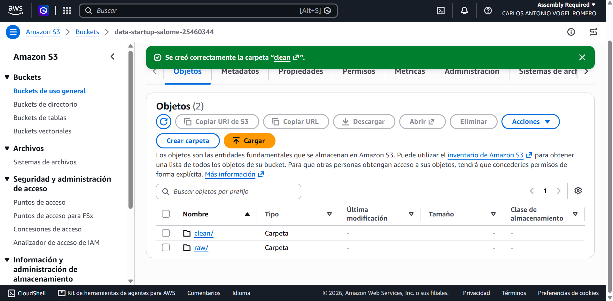
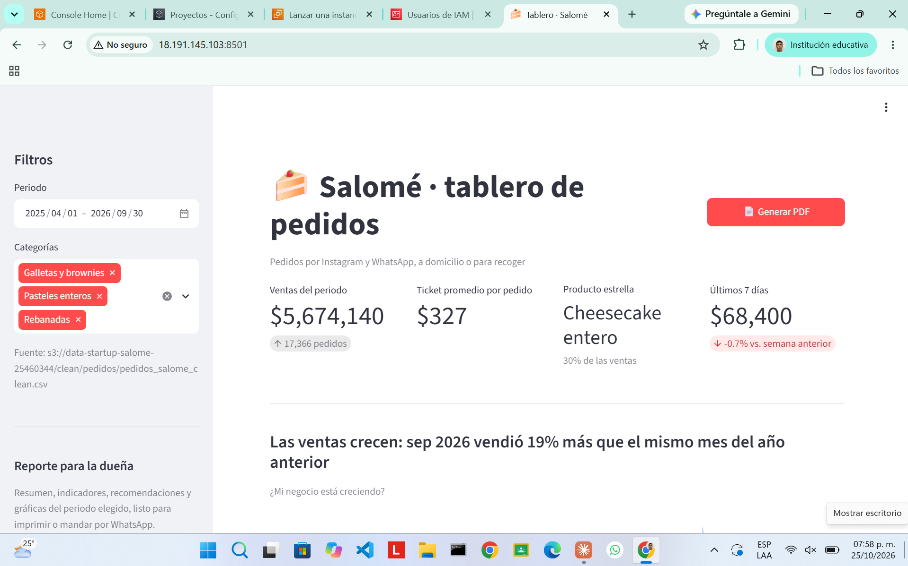
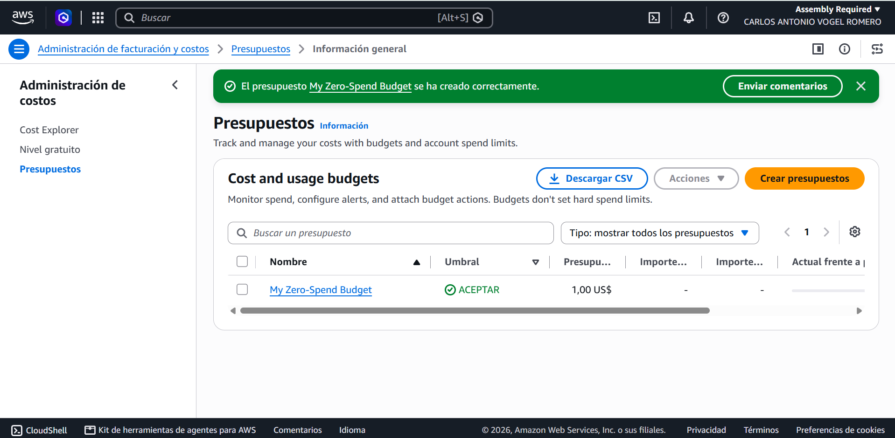

# E1 · Dashboard empresarial — Salomé

**Proyecto Integrador DATA STARTUP** · Cómputo en la Nube (IAD-2408) × Analítica de Datos (IAD-2403)
Integrantes: Jarom Cortes Perez (Cloud Lead) · Carlos Antonio Vogel Romero (Data Lead) · Fecha: 23 de octubre de 2026

> Salomé no tiene tienda física: todos sus pedidos llegan por Instagram y WhatsApp. Este tablero
> convierte ese historial de pedidos en decisiones de producción. Los títulos y las recomendaciones se
> calculan directamente de los datos, así que se actualizan solos cuando llegan pedidos nuevos.

## 1. Datos

| Concepto | Valor |
|---|---|
| Fuente | Historial de pedidos de Salomé por Instagram y WhatsApp |
| Periodo | 1 de abril de 2025 al 30 de septiembre de 2026 (548 días, 18 meses) |
| Volumen | 25,074 registros crudos · 17,366 pedidos |
| Columnas | `pedido_id`, `fecha`, `hora` (hora del mensaje), `producto`, `categoria`, `unidades`, `precio_unitario`, `total`, `canal`, `entrega`, `metodo_pago` |
| Productos | Cheesecake clásico y tres leches (rebanada), brownie, galleta con chispas, cheesecake entero y pastel de temporada |
| Temporadas relevantes | San Valentín, 10 de mayo, graduaciones, Día de Muertos, diciembre y cuesta de enero |

## 2. Limpieza (`services/worker/limpieza.py`)

La limpieza es un módulo de Python reutilizable; en E2 lo ejecutará el worker de la cola.

| Tipo de error | Qué se encontró | Registros | Corrección |
|---|---|---:|---|
| Duplicados | Filas idénticas repetidas | 30 | Eliminadas |
| Formato | Nombre de producto en minúsculas o con espacios | 45 | Unificado al nombre oficial |
| Tipo de dato | Unidades escritas como texto ("2 pz") | 12 | Convertidas a número |
| Faltantes | Precio unitario vacío | 20 | Precio de catálogo del producto |
| Faltantes | Unidades vacías | 40 | Reconstruidas con total ÷ precio |
| Error lógico | Unidades negativas | 15 | Reconstruidas con total ÷ precio |
| Atípicos | Unidades imposibles (999) | 10 | Reconstruidas con total ÷ precio |
| Error lógico | Total ≠ unidades × precio | 20 | Total recalculado |
| Irrecuperables | Sin forma de reconstruir | 0 | — |

Resultado: **25,044 registros limpios** en `clean/`.

## 3. Indicadores (KPI)

| Indicador | Valor (periodo completo) |
|---|---|
| Ventas del periodo | $5,674,140 en 17,366 pedidos |
| Ticket promedio por pedido | $327 (mediana $225) |
| Producto estrella | Cheesecake entero, 30% de las ventas |
| Últimos 7 días vs. semana anterior | $68,400 · −0.7% |

## 4. Visualizaciones (cada título es el hallazgo)

| # | Tipo | Pregunta | Hallazgo |
|---|---|---|---|
| 1 | Líneas | ¿Mi negocio está creciendo? | Septiembre 2026 vendió 19% más que septiembre 2025; los picos son 10 de mayo, San Valentín y diciembre |
| 2 | Histograma (16 bins, regla de Sturges) | ¿Cuánto gasta un cliente por pedido? | La mitad de los pedidos es de $225 o menos; 1 de cada 10 pasa de $680, por los pasteles enteros |
| 3 | Mapa de calor día × hora | ¿Cuándo llegan los pedidos? | Los pedidos llegan sobre todo de noche; el pico es el sábado de 21 a 22 h |
| 4 | Dispersión pedidos vs. venta | ¿Vendo más por más pedidos o por pedidos más grandes? | Cada pedido extra deja $364 (r = 0.92): la venta depende de cuántos mensajes se convierten en pedido |
| 5 | Análisis espectral (FFT) | ¿Mis ventas siguen ciclos? | Ciclo dominante de 7 días y otro de ~14 días (quincena) |
| 6 | Barras apiladas por mes y categoría | ¿Qué vendo en cada temporada? | Los pasteles enteros se disparan en diciembre: 2.0 veces su promedio diario del año |

## 5. Análisis espectral

1. Se suman las ventas por día y se rellena con 0 cualquier día sin pedidos para que la serie sea regular (Δt = 1 día).
2. Se quita la tendencia restando la media móvil de 28 días, para que la FFT no confunda el crecimiento con un ciclo largo.
3. Se aplica `numpy.fft.rfft` y se calcula la potencia |X(f)|². El periodo de cada componente es **T = 1/f** días.
4. Picos encontrados:
   - **7.0 días (ciclo semanal)**, el más fuerte. Venta promedio por día: lunes $7,837 · martes $6,974 · miércoles $8,072 · jueves $9,889 · viernes $12,229 · **sábado $15,452** · domingo $12,100.
   - **~14 días (quincena)**. Los días 15, 16, 30, 31 y 1 se vende **17% más** que un día normal. El pico no cae exactamente en 15 porque los meses duran entre 28 y 31 días.

**Para el negocio:** la producción no puede ser igual todos los días. Se planea por semana (más de viernes a domingo) y se ajusta en quincena.

## 6. Recomendaciones para Salomé

1. **Prepara según el día, no igual toda la semana.** El sábado se vende 2.2 veces lo del martes. Como el cheesecake necesita reposar, decide la producción del fin de semana desde el jueves: menos merma entre semana y menos pedidos rechazados el sábado.
2. **Aprovecha la quincena.** Esos días se vende 17% más. Ten base lista de cheesecake entero y cheesecake clásico para los días 15-16 y 30-1, y publica ahí tus promociones en Instagram.
3. **Contesta rápido de noche.** El 53% de las ventas entra por mensajes de las 19 h en adelante y el pico es a las 21 h. Publica historias antes de esa hora y deja respuestas rápidas con menú y precios en WhatsApp: un mensaje que tarda en contestarse es un pedido que se va a otra postrería.

## 7. Nube (AWS · tema 2.4)

| Requisito | Cómo se cumple | Evidencia |
|---|---|---|
| Almacenamiento con dos zonas | Bucket S3 con `raw/` y `clean/`, acceso público bloqueado y cifrado por defecto (SSE-S3) |  |
| Convención de nombres | `raw/pedidos/fecha_carga=AAAA-MM-DD/pedidos_salome.csv` (inmutable) y `clean/pedidos/pedidos_salome_clean.csv` (versión vigente) | Este documento |
| Tablero lee de `clean/` en la nube | `app.py` usa boto3 y lee `s3://<bucket>/clean/pedidos/…` |  |
| Credenciales fuera del código | Credenciales temporales en `~/.aws/credentials` y nombre del bucket en `.streamlit/secrets.toml` (en `.gitignore`) | `.gitignore`, `secrets.toml.example` |
| Acceso seguro | Cuenta de AWS Academy administrada por la institución: no hay cuenta raíz propia ni se pueden crear usuarios IAM; cada integrante entra con su propio acceso al Learner Lab y credenciales temporales. La política de mínimo privilegio del tablero (solo `s3:GetObject` sobre `clean/*`) está lista en `infra/iam/` para aplicarse en cuanto el proyecto pase a una cuenta propia. |  |
| Control de presupuesto | Crédito fijo del Learner Lab sin tarjeta; el panel muestra el gasto acumulado |  |

**Por qué almacenamiento de objetos:** los CSV se escriben una vez y se leen muchas; S3 es barato, no
necesita servidor y es la base natural de un data lake. El almacenamiento en bloques (EBS) solo sirve
conectado a una máquina, y el de archivos (EFS) sirve para carpetas compartidas que se editan, que no es
este caso.

## 8. Uso de IA generativa

Se usó Claude (Anthropic) para generar el código base del generador de datos, del módulo de limpieza y
del tablero, y para redactar el borrador de este documento. Todo el código se revisó, se ejecutó y se puede
explicar en la defensa.
