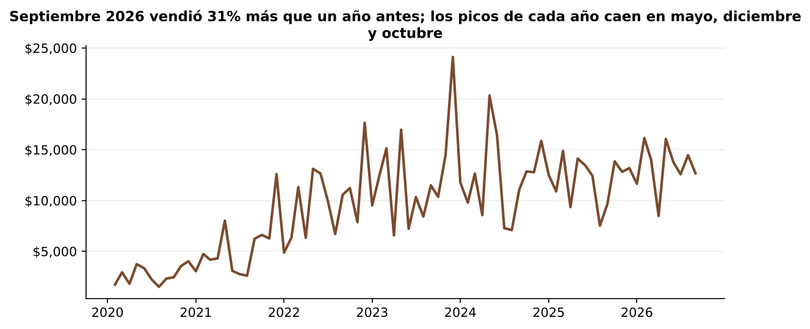
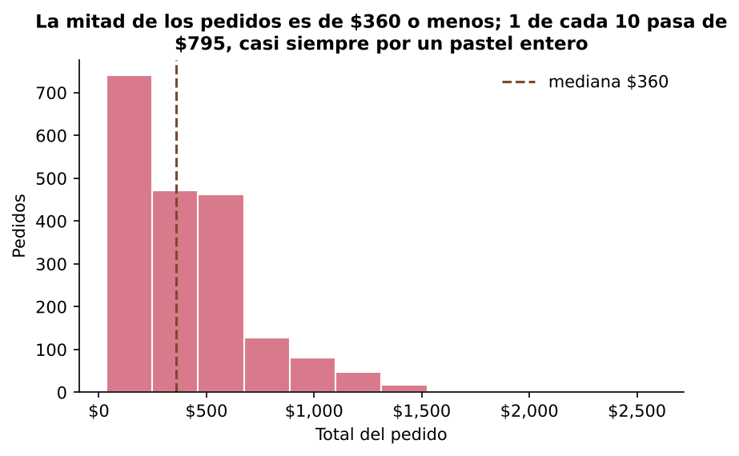
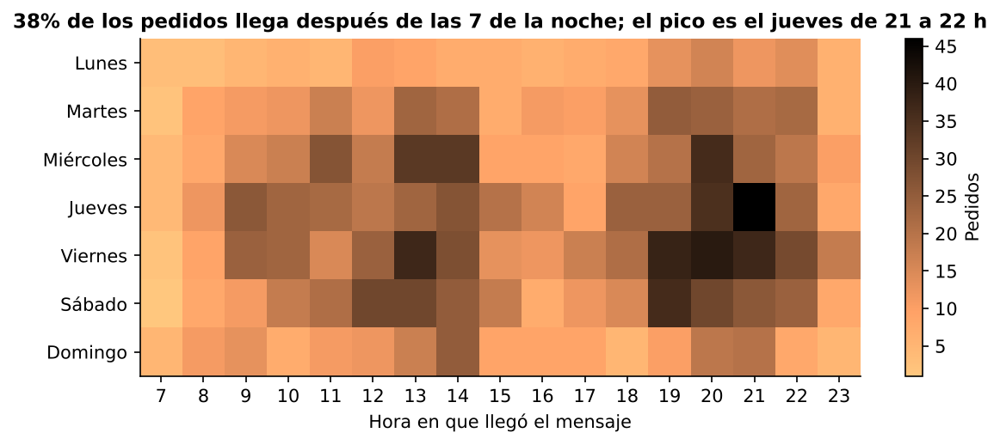
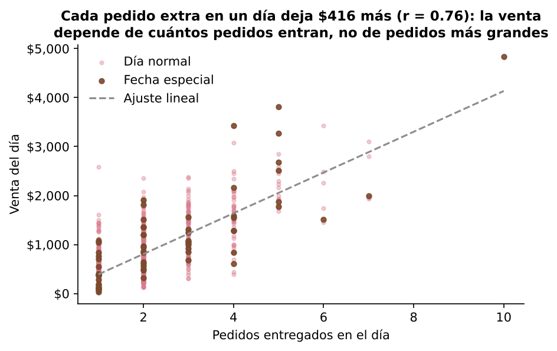
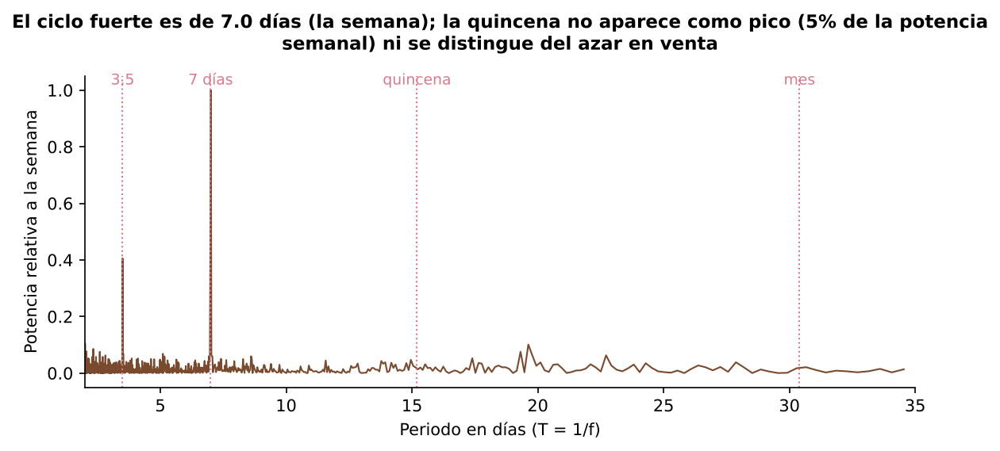
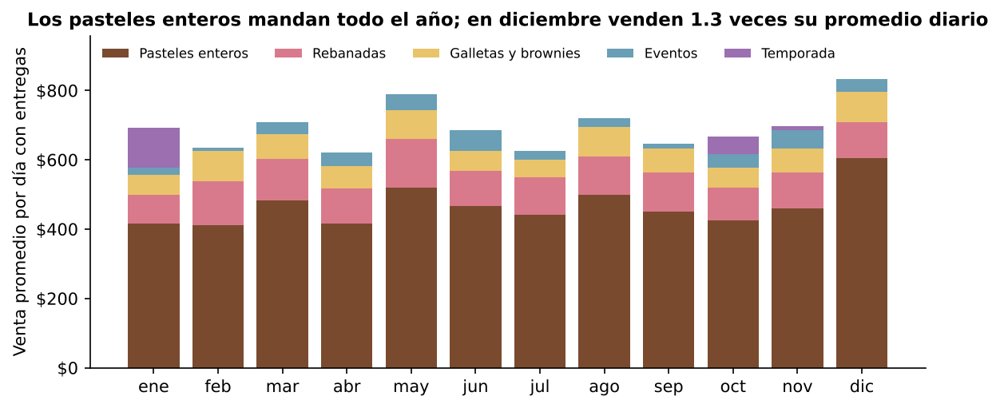
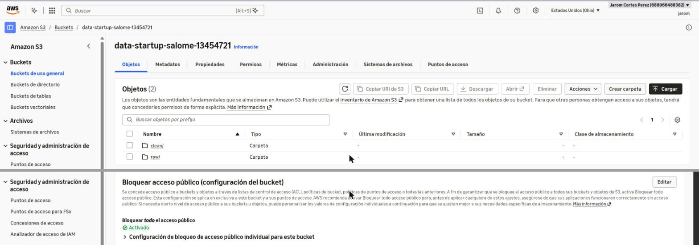
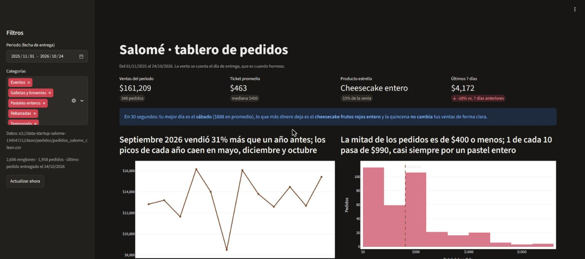
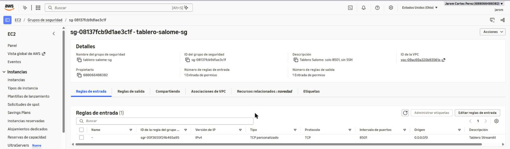
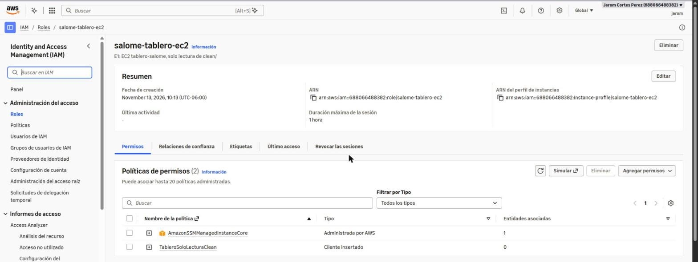

# E1 · Dashboard empresarial de Salomé

Proyecto integrador DATA STARTUP · Cómputo en la Nube (IAD-2408) × Analítica de Datos (IAD-2403) · TecNM Campus Colima

| | |
|---|---|
| Integrantes | Jarom Cortes Pérez (Cloud Lead) · Carlos Antonio Vogel Romero (Data Lead) |
| Repositorio | https://github.com/Vogelito09-lab/data-startup-postreria · etiqueta `e1` |
| Tablero | http://18.227.72.184:8501 (EC2 `tablero-salome`; la IP cambia si se apaga la instancia) |
| Versión | Corregida, 12 de noviembre de 2026. Se recalcularon todos los números con el historial completo (2020 a 2026). |

El tablero convierte el historial de pedidos de Salomé en decisiones de producción. Los títulos de las gráficas y las recomendaciones se calculan con los datos (`services/tablero/analitica.py`), así que cambian solos cuando entran pedidos nuevos. Las cifras de este documento corresponden a los datos hasta el 24 de octubre de 2026 y se reproducen con `python scripts/figuras_docs.py` y el notebook `notebooks/E1_limpieza_y_hallazgos.ipynb`.

## 1. Datos

| Concepto | Valor |
|---|---|
| Periodo | 6 de febrero de 2020 (primera entrega) al 24 de octubre de 2026 |
| Volumen | 2,619 renglones crudos · 2,606 limpios · 1,958 pedidos · 708 clientes anónimos |
| Productos | 12: cheesecake de frutos rojos (entero y rebanada), pay de limón (entero y rebanada), tres leches (entero y rebanada), caja de brownies, galletas con chispas (hasta junio de 2024), flan napolitano (2022 a 2023), cupcakes para eventos, rosca de Reyes y pan de muerto |
| Cómo se cuenta la venta | En la fecha de entrega, porque ese es el día que Salomé produce |
| Origen | Historial de pedidos de Salomé (E0, sección 6) |

## 2. Limpieza

El código está en `services/worker/limpieza.py` y no adivina: si un valor se puede reconstruir con otra columna del mismo renglón, se reconstruye; si no, el renglón se aparta y se reporta. Desde E2 este mismo módulo lo ejecuta el worker de la cola.

| Tipo de error | Qué se encontró | Renglones | Corrección |
|---|---|---|---|
| Duplicados | El mismo renglón copiado dos veces del chat | 13 | Se elimina la copia |
| Formato | Nombre de producto escrito distinto ("Cheescake", "pay de limon", "Brownies 6pz", espacios de más) | 38 | Se unifica al nombre del catálogo por clave sin acentos, alias y similitud de texto |
| Formato | Un nombre irreconocible ("flan entero") | 1 | Se identifica por su categoría y su precio de lista de ese día |
| Formato | Canal abreviado ("WA", "IG", "face") | 26 | Se unifica a WhatsApp, Instagram o Facebook |
| Tipo de dato | Unidades escritas como texto ("2 pz", "dos", "1 entero") | 10 | Se convierten a número |
| Tipo de dato | Fecha en formato día/mes/año | 26 | Se convierte a AAAA-MM-DD |
| Faltantes | Precio unitario vacío | 7 | Precio de lista vigente en la fecha del pedido |
| Faltantes | Unidades vacías | 7 | total ÷ precio, solo si da un entero positivo |
| Faltantes | Hora del mensaje vacía | 13 | No se imputa: se queda vacía y esos pedidos no entran al mapa de calor |
| Error lógico | Unidades negativas | 3 | Valor absoluto (el total era positivo) |
| Error lógico | Fecha de entrega anterior a la del pedido | 4 | Año viejo tecleado en enero: se suma un año; si no, se voltean las fechas |
| Error lógico | Total distinto de unidades × precio | 10 | Se recalcula el total |
| Atípicos | Unidades imposibles para una persona (10 pasteles enteros en un renglón: un cero de más) | 5 | total ÷ precio. Los pedidos grandes de cupcakes para eventos, que sí son reales, se conservan |
| Irrecuperables | Sin forma de reconstruir | 0 | Se apartarían con su reporte |

Resultado: 2,606 renglones limpios en `clean/`. El archivo limpio pasa todas las reglas de `validar_limpio` (sin duplicados, sin faltantes críticos, total igual a unidades × precio, entrega posterior al pedido) y cada regla de limpieza tiene su prueba automática en `tests/test_limpieza.py`.

## 3. Indicadores

| Indicador | Valor |
|---|---|
| Ventas del periodo | $786,227 en 1,958 pedidos |
| Ticket promedio por pedido | $402 (mediana $360) |
| Producto estrella | Cheesecake de frutos rojos entero, 35% de la venta |
| Últimos 7 días contra los 7 anteriores | $4,172 del 18 al 24 de octubre contra $5,115 de la semana previa (−18%) |

Con poco más de un pedido por día, una semana puede subir o bajar 20% solo porque entró o no entró un pastel entero. El tablero muestra la variación tal cual; para decidir conviene mirar la tendencia de varias semanas y no una sola.

## 4. Visualizaciones

Cada título es el hallazgo. En el tablero se pueden filtrar por periodo y categoría.



Tendencia de venta mensual (líneas). El negocio creció rápido de 2020 a 2023 y desde ahí se quedó en unos 12 mil pesos al mes. 2025 cerró 1% abajo de 2024 en pesos y 3% abajo en piezas: vendió un poco menos y las alzas de precio casi lo compensaron. Septiembre de 2026 vendió 31% más que septiembre de 2025, que fue un mes flojo.



Distribución del ticket (histograma con 12 barras por la regla de Sturges, k = 1 + log₂ 1,958). La distribución tiene sesgo a la derecha: la mitad de los pedidos es de $360 o menos y el 10% más alto pasa de $795, casi siempre porque incluye un pastel entero o cupcakes para un evento.



Mapa de calor de pedidos por día y hora del mensaje. 38% de los pedidos llega después de las 7 de la noche, con el pico el jueves entre 9 y 10 de la noche: la gente aparta el pastel del fin de semana desde antes.



Relación entre pedidos y venta por día (dispersión). Cada pedido adicional en un día suma $416 en promedio y la correlación de Pearson es r = 0.76. Los días de venta alta lo son porque entran más pedidos, no porque cada pedido sea más grande.



Análisis espectral (sección 5).



Composición por mes y categoría (barras apiladas, venta promedio por día con entregas). Los pasteles enteros son dos tercios de la venta. Diciembre y mayo son los meses más altos y en diciembre los enteros venden 1.3 veces su promedio diario. En enero aparece la rosca y en octubre el pan de muerto.

## 5. Análisis espectral

1. Se suma la venta por día de entrega y se rellena con 0 cada día sin entregas (lunes, vacaciones), para tener una serie regular con Δt = 1 día (2,453 días).
2. Se le resta su media móvil centrada de 28 días. Sin esto, el crecimiento de 2020 a 2023 aparece como un ciclo largo falso.
3. Se aplica `numpy.fft.rfft`, se calcula la potencia |X(f)|² y el periodo de cada componente con T = 1/f.

| Pico | Periodo | Potencia relativa | Qué significa |
|---|---|---|---|
| 1 | 7.0 días | 1.00 | El ciclo semanal |
| 2 | 3.5 días | 0.41 | Armónico de la semana (7/2) |
| 3 | 19.6 días | 0.10 | Ruido; no corresponde a nada del calendario |
| 4 | 2.33 días | 0.09 | Armónico de la semana (7/3) |
| cerca de 15.2 | quincena | 0.05 | No sobresale |
| cerca de 30.4 | mes | 0.02 | No sobresale |

Los armónicos de 3.5 y 2.33 días salen porque la semana de Salomé no tiene forma de seno: el lunes vale cero y el sábado sube de golpe, y una onda cuadrada se descompone en la frecuencia base más sus múltiplos. No son ciclos nuevos.

Venta promedio por día abierto (contando los días que abrió y no le pidieron nada): martes $210, miércoles $281, jueves $323, viernes $489, sábado $604 y domingo $443. El sábado vende 2.9 veces lo del martes. En 44% de los días que abrió no hubo ninguna entrega; seis de cada diez de esos días caen entre martes y jueves. Los pocos lunes que abre son fechas fuertes, por eso su promedio ($313) no se compara con los demás.

La quincena no aparece en el espectro. Salomé siente que en quincena se mueve más, así que la buscamos también de otra forma: comparamos cada día abierto de quincena (1, 14, 15, 16 y los dos últimos del mes) contra el promedio de su mismo día de la semana en el mismo año, sin contar fechas especiales. Desde 2022, en quincena se vende 7% más, pero la diferencia no es significativa (prueba t de Welch, p = 0.41, 259 días de quincena contra 1,102 normales). Con poco más de un pedido diario el ruido es tan grande que un efecto de ese tamaño no se distingue del azar. No podemos confirmar la quincena con estos datos; si existe, es mucho menor que el efecto del sábado.

Para el negocio: la producción se planea por semana y se concentra de viernes a domingo. La quincena no justifica hornear más.

## 6. Recomendaciones para Salomé

Calculadas con el último año de pedidos.

1. Arma el fin de semana desde el jueves. El sábado vendes 2.9 veces lo de un martes, y el jueves en la noche ya tienes apartados 69% de los pasteles enteros del sábado. Con esa cuenta puedes dejar listos los cheesecakes que necesitan reposar y comprar el queso crema justo. Entre semana no hornees de más: en 58% de los martes y miércoles que abriste no hubo ninguna entrega.
2. Los sábados fuertes ya llegan a tu tope: aparta con anticipo. En 6 de los últimos 51 sábados entregaste cuatro pasteles enteros, que es lo más que sale de tu cocina en un día normal. Esos días seguro le dijiste que no a alguien. Abre la agenda del sábado el miércoles en tus historias y, cuando se llene, ofrece entrega el domingo.
3. Contesta rápido de noche. 35% de los pedidos del último año llegó después de las 7 de la noche. Publica el menú en historias por la tarde y deja respuestas rápidas en WhatsApp con precios para contestar al momento. La quincena no mueve tus ventas de forma clara, así que no cambies la producción por ella.

## 7. Nube (AWS · tema 2.4)

Los pedidos viven en un bucket de S3 con dos zonas. Una instancia EC2 t3.micro corre el tablero de Streamlit como servicio de systemd y lee `clean/` con un rol de IAM, sin llaves en el código ni en el servidor.

```
Pedidos (CSV) ──► S3 data-startup-salome-13454721
                   ├── raw/pedidos/fecha_carga=2026-10-24/historial.csv     (tal como llegó)
                   └── clean/pedidos/pedidos_salome_clean.csv             (versión vigente)
                                  │  s3:GetObject solo sobre clean/pedidos/*
                                  ▼
                 EC2 t3.micro ── Streamlit :8501 ──► navegador de Salomé
```

| Requisito | Cómo se cumple | Evidencia |
|---|---|---|
| Almacenamiento con dos zonas | Bucket `data-startup-salome-13454721` con `raw/` y `clean/`, acceso público bloqueado y cifrado por defecto (SSE-S3) | Captura del bucket |
| Convención de nombres | `raw/pedidos/fecha_carga=AAAA-MM-DD/<archivo>.csv`: inmutable, particionado por día de carga (estilo Hive, para que Athena o Glue lo lean después). `clean/pedidos/pedidos_salome_clean.csv`: la versión vigente que se sobrescribe | Este documento |
| Tablero lee de `clean/` en la nube | `services/tablero/fuente.py` con `FUENTE=s3` usa boto3 y lee `s3://data-startup-salome-13454721/clean/pedidos/pedidos_salome_clean.csv`; la barra lateral muestra la fuente | Captura del tablero |
| Credenciales fuera del código | El servidor usa un perfil de instancia; no hay llaves en el código, en el repositorio ni en el servidor. `.gitignore` excluye `.env`, `secrets.toml` y `data/historial/` | `.gitignore` |
| Mínimo privilegio | Política `TableroSoloLecturaClean`: solo `s3:GetObject` sobre `clean/pedidos/*` (`infra/iam/politica-tablero.json`). El tablero no puede escribir, borrar ni leer `raw/` | Política en el repositorio |
| Acceso seguro a la cuenta | Un usuario de IAM por integrante (el del Cloud Lead, que opera la infraestructura, con MFA), sin llaves de acceso de larga duración (la terminal usa `aws login`). La cuenta raíz tiene MFA, no tiene llaves de acceso y no se usa para operar. El grupo de seguridad abre solo el 8501; no hay SSH, la administración es por Session Manager | Capturas de IAM y del grupo de seguridad |
| Control de presupuesto | Plan gratuito y alerta de Budgets; la instancia se detiene cuando no se usa | Captura de Budgets |

Por qué almacenamiento de objetos: los CSV se escriben una vez y se leen muchas, S3 no necesita servidor, cobra por lo que se guarda y es la base de un data lake. El almacenamiento en bloques (EBS) solo existe pegado a una máquina y el de archivos (EFS) sirve para carpetas que varios servidores editan a la vez; ninguno es nuestro caso. Un data warehouse (Redshift) tendría sentido con muchos clientes y consultas pesadas, no con tres mil renglones.

### Evidencia









## 8. Uso de IA generativa

Claude (Anthropic) generó el código base del módulo de limpieza y del tablero, y el borrador de este documento. Revisamos y ejecutamos todo el código; las pruebas automáticas (`python -m pytest tests/`) cubren cada regla de limpieza.
