# E2 · Cimientos en la nube: los pedidos viajan solos

Proyecto integrador DATA STARTUP · Cómputo en la Nube (IAD-2408) × Analítica de Datos (IAD-2403) · TecNM Campus Colima

| | |
|---|---|
| Integrantes | Jarom Cortes Pérez (Cloud Lead) · Carlos Antonio Vogel Romero (Data Lead) |
| Repositorio | https://github.com/Vogelito09-lab/data-startup-postreria · etiqueta `e2` |
| API de ingesta | `http://<IP de tablero-salome>:8000/docs` (abierta solo a la IP del equipo) |
| Tablero v2 | `http://<IP de tablero-salome>:8501` |
| Fecha | 12 de noviembre de 2026 |

En E1 los datos se subieron a mano. Ahora Salomé (o nosotros por ella) sube un CSV a una API, la API lo guarda tal cual en `raw/`, avisa por una cola, y un worker lo limpia, lo escribe en `clean/` y en PostgreSQL. El tablero lee de la base y se actualiza solo. Nadie toca nada en medio.

## 1. Arquitectura

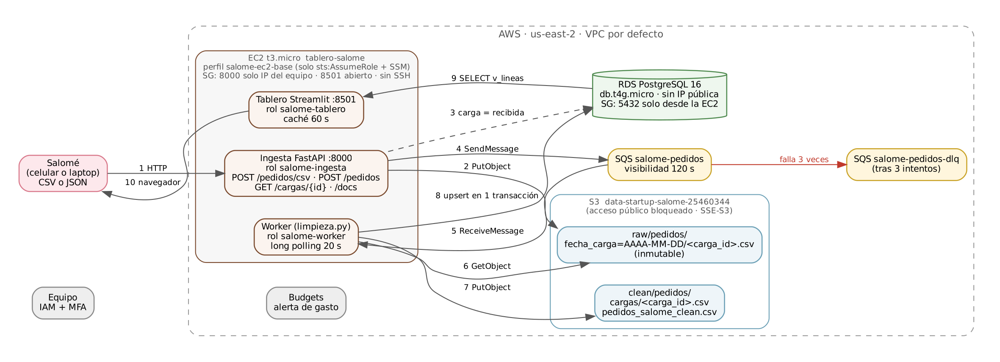

Fuente del diagrama: `docs/arquitectura_e2.dot`.

| Pieza | Qué hace | Por qué esta y no otra |
|---|---|---|
| API de ingesta (FastAPI en EC2) | Valida el archivo, lo guarda en `raw/`, registra la carga y publica un mensaje | Responde en milisegundos con 202 y no espera a la limpieza. FastAPI genera la documentación OpenAPI sola |
| S3 `raw/` | Copia inmutable de cada carga, una por archivo: `raw/pedidos/fecha_carga=AAAA-MM-DD/<carga_id>.csv` | Si una regla de limpieza cambia, se reprocesa desde aquí. Nadie tiene permiso de borrarla |
| SQS `salome-pedidos` | Cola entre la ingesta y el worker | Desacopla: si el worker se cae, los mensajes esperan hasta 4 días. Es administrada y su capa gratuita (un millón de solicitudes al mes) sobra |
| SQS `salome-pedidos-dlq` | Cola de mensajes fallidos | Después de 3 intentos fallidos, el mensaje se aparta para revisarlo en vez de reintentarse para siempre |
| Worker (Python en EC2) | Consume la cola, limpia con `limpieza.py`, escribe en `clean/` y en la base | Mismo código de E1, ahora automático. En E3 se convierte en Lambda |
| S3 `clean/` | `cargas/<carga_id>.csv` por carga y `pedidos_salome_clean.csv` consolidado | El consolidado mantiene compatible lo que el tablero leía en E1 |
| RDS PostgreSQL 16 (db.t4g.micro) | Pedidos para consultas del tablero y estado de cada carga | Relacional porque los datos lo son (sección 2). Administrada: respaldos, parches y cifrado los pone AWS |
| Tablero (Streamlit en EC2) | Lee la vista `v_lineas` con caché de 60 segundos | Muestra el dato nuevo en menos de un minuto sin saturar la base |

Límites de red: los tres servicios viven en la misma EC2. Su grupo de seguridad abre el 8501 (tablero) a internet y el 8000 (ingesta) solo a la IP del equipo; no hay SSH, se administra por Session Manager. La base no tiene IP pública y su grupo de seguridad solo acepta el puerto 5432 desde el grupo de la EC2. S3 y SQS se usan por sus endpoints públicos con HTTPS y credenciales temporales del rol. En E4 se cierran el 8000 y el 8501 detrás de un solo 443 con TLS.

Monolito contra microservicios: separamos ingesta, worker y tablero en tres procesos con su propio rol, su propio usuario de base de datos y su propia unidad de systemd. Se pueden reiniciar, escalar o mover por separado (en E3 cada uno será un contenedor). El precio es más piezas que vigilar; por eso cada servicio tiene `Restart=always` y el estado de cada carga queda en la tabla `cargas`.

## 2. Base de datos

Esquema en `infra/sql/esquema.sql`; usuarios y permisos en `infra/sql/usuarios.sql`.

| Tabla | Llave | Contenido |
|---|---|---|
| `productos` | `producto_id` (serial), `nombre` único | Catálogo con su categoría |
| `clientes` | `cliente_id` (texto anónimo) | Fecha del primer pedido. Nunca nombre ni teléfono |
| `pedidos` | `pedido_id` | Cliente, fechas, hora, canal, entrega, método de pago y la carga que lo trajo |
| `lineas_pedido` | (`pedido_id`, `producto_id`) | Unidades, precio y total de cada producto del pedido |
| `cargas` | `carga_id` (UUID) | Llave de S3, estado (`recibida`, `procesando`, `procesada`, `error`), intentos, conteos y reporte de limpieza en JSONB |

La base impone reglas que el CSV no puede: `fecha_entrega >= fecha_pedido`, `unidades > 0`, `total = unidades × precio_unitario`, valores permitidos de canal, entrega y método de pago, y llaves foráneas. Si algo se escapara de la limpieza, la transacción falla y el mensaje se reintenta en vez de meter basura.

Índices: `pedidos(fecha_entrega)` y `lineas_pedido(producto_id)` para las consultas por día y por producto del tablero, `pedidos(cliente_id)` para la cadena de Markov de E4 y `cargas(recibida_en DESC)` para el panel de últimas cargas. Las vistas `v_lineas` (misma forma que el CSV limpio) y `v_ventas_diarias` son lo único que lee el tablero.

Transacciones e idempotencia: SQS entrega cada mensaje al menos una vez, así que el mismo archivo puede procesarse dos veces. El worker escribe cada carga en una sola transacción: inserta o actualiza pedidos con `ON CONFLICT`, borra los renglones previos de esos pedidos y vuelve a insertarlos. Reenviar el mismo CSV deja la base igual; lo probamos.

SQL contra NoSQL: elegimos PostgreSQL porque los datos son relacionales (pedido, renglón, producto, cliente), las preguntas del tablero son agregaciones por fecha y producto que SQL resuelve en una línea, y necesitamos transacciones y restricciones para que una carga entre completa o no entre. Una base de documentos como DynamoDB serviría para leer un pedido por su llave, pero cada agregado por día obligaría a leer toda la tabla o a mantener contadores aparte. Con tres mil renglones, el volumen no justifica escalar horizontalmente.

Si en algún momento RDS dejara de entrar en los créditos, el plan B que permite el proyecto es PostgreSQL en un contenedor en la misma EC2. Ganaríamos costo cero; perderíamos respaldos automáticos, parches, cifrado administrado y, sobre todo, memoria en una máquina de 1 GB que ya corre tres servicios.

## 3. Microservicio de ingesta

Código: `services/ingesta/app.py`. Documentación OpenAPI viva en `/docs` y exportada en `docs/openapi-ingesta.json`.

| Endpoint | Para qué | Respuestas |
|---|---|---|
| `POST /pedidos/csv` | Subir un CSV (campo `archivo`) | 202 con `carga_id` · 400 vacío o no UTF-8 · 413 más de 5 MB o de 50,000 renglones · 422 faltan columnas, renglón cortado o `pedido_id` no numérico · 503 falla temporal de S3 o SQS |
| `POST /pedidos` | Enviar renglones como JSON | 202 · 422 con el campo exacto que falló (por ejemplo, `cliente_id` debe ser un código `C####`, así se rechaza un nombre de persona) |
| `GET /cargas/{carga_id}` | Ver si la carga ya se procesó y su reporte de limpieza | 200 · 404 |
| `GET /salud` | Revisión de vida | 200 |

La validación de entrada revisa la forma del archivo, no la calidad de los datos. `raw/` tiene que guardar lo que llegó tal cual, con sus errores, porque corregirlos es trabajo del worker y queda reportado. Lo que sí se rechaza en la puerta es lo que haría imposible procesar el archivo o lo que nunca debería entrar (tamaño, codificación, columnas, identificadores).

Manejo de errores: el orden es S3, base y cola. Si S3 falla, se responde 503 y no se publica nada. Si la base falla, la carga sigue (el worker la registra después). Si la cola falla, se responde 503 diciendo que el archivo ya quedó en `raw/` y que hay que reenviarlo.

## 4. Cola y worker

Código: `services/worker/worker.py`.

| Parámetro | Valor | Motivo |
|---|---|---|
| Long polling | 20 segundos | Menos llamadas vacías: unas 130 mil solicitudes al mes con el worker siempre encendido, dentro del millón gratuito |
| Tiempo de visibilidad | 120 segundos | El archivo más grande tarda medio segundo; hay margen de sobra |
| Reintentos | El mensaje no se borra si algo falla; vuelve a la cola a los 15, 30 y 60 segundos (espera creciente con `ChangeMessageVisibility`) | Las fallas pasajeras de red o de base se arreglan solas |
| Cola de mensajes fallidos | `maxReceiveCount = 3` hacia `salome-pedidos-dlq`, con retención de 14 días | Un archivo roto no se reintenta para siempre y queda para revisarlo |
| Borrado del mensaje | Solo después de escribir `clean/` y confirmar la transacción en la base | Así nunca se pierde una carga |

Cada carga pasa por: registrar → descargar de `raw/` → limpiar → validar (`validar_limpio`) → escribir `clean/pedidos/cargas/<id>.csv` → actualizar el consolidado → transacción en PostgreSQL → marcar `procesada` con el reporte → borrar el mensaje.

Prueba de reintentos: enviamos a la cola un mensaje que apunta a un archivo que no existe. El worker falló al recibirlo y otra vez a los 15 y a los 45 segundos, la tabla `cargas` quedó con `estado = error`, `intentos = 3` y el mensaje de error, y en el cuarto intento SQS lo movió a la DLQ.

## 5. Identidad y acceso

El servidor tiene un perfil de instancia, `salome-ec2-base`, que solo puede hacer dos cosas: asumir uno de los tres roles de servicio y conectarse a Session Manager. Cada servicio corre con su propio perfil de AWS (`AWS_PROFILE=ingesta`, `worker` o `tablero` en `/etc/salome/aws_config`) y recibe credenciales temporales de su rol. Ninguna llave se guarda en disco.

| Rol | Puede | No puede |
|---|---|---|
| `salome-ingesta` | `s3:PutObject` en `raw/pedidos/*` · `sqs:SendMessage` | Leer `raw/` o `clean/`, leer la cola, borrar |
| `salome-worker` | `s3:GetObject` en `raw/pedidos/*` · `s3:GetObject` y `s3:PutObject` en `clean/pedidos/*` · `s3:ListBucket` solo con esos prefijos · recibir, borrar y cambiar visibilidad en la cola | Escribir o borrar en `raw/`, borrar en `clean/`, publicar en la cola, listar el resto del bucket, tocar IAM o crear recursos |
| `salome-tablero` | `s3:GetObject` en `clean/pedidos/*` | Escribir en cualquier lado, leer `raw/` |

Políticas en `infra/iam/`. El `ListBucket` del worker existe por una razón práctica: sin él, S3 contesta "acceso denegado" en vez de "no existe" cuando el consolidado todavía no se ha creado.

En la base pasa lo mismo: `salome_ingesta` solo inserta y consulta `cargas`; `salome_worker` escribe pedidos, renglones y clientes, y actualiza `cargas`, pero no puede borrar cargas ni cambiar el esquema; `salome_tablero` solo lee las vistas. El usuario maestro solo se usó para crear el esquema.

Demostración: `infra/aws/probar_privilegios.sh` intenta 16 acciones con cada perfil y marca si AWS respondió lo esperado (por ejemplo, que el worker no pueda escribir en `raw/`).

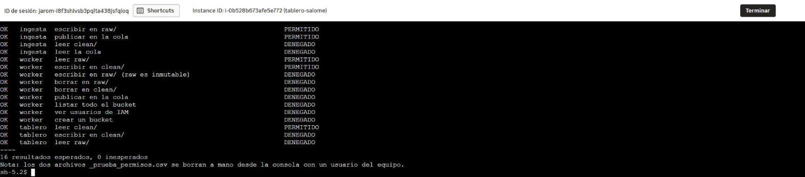

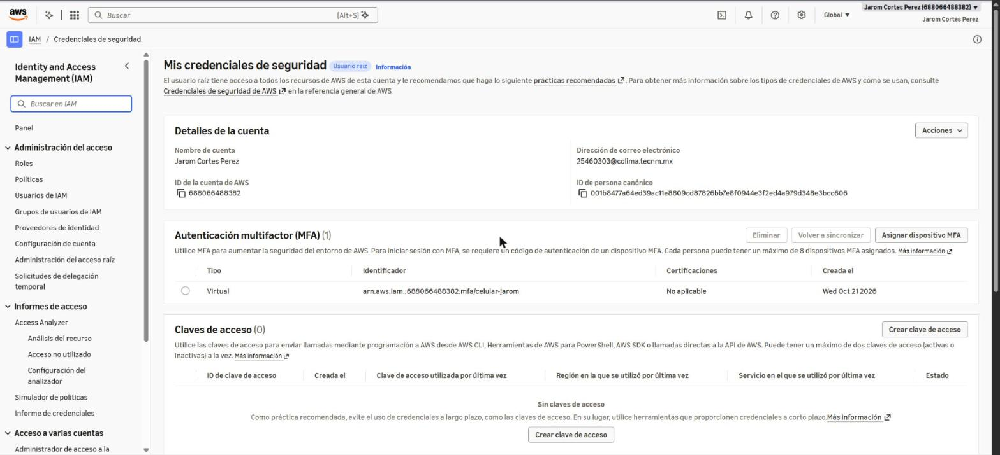

## 6. Flujo de punta a punta

Lo que se demuestra en vivo, con `tests/demo_punta_a_punta.sh`:

1. Se sube `data/sample/semana_2026-10-25.csv` (8 renglones, los pedidos de la semana del 25 al 31 de octubre, con sus errores de captura) a `POST /pedidos/csv`.
2. La API contesta 202 con el `carga_id`.
3. El script consulta `GET /cargas/{id}` cada 2 segundos hasta que dice `procesada`, y muestra el reporte de limpieza.
4. En el tablero, la última fecha entregada pasa del 24 al 31 de octubre y el panel de últimas cargas muestra la nueva.

En nuestra prueba con el mismo código (S3 y SQS emulados con moto y PostgreSQL 16 local), la carga del historial completo (2,619 renglones) quedó procesada en 0.5 segundos y la de la semana nueva en 0.2 segundos, medidos desde que la API la recibió hasta que el worker la marcó como procesada. La base y el consolidado de `clean/` terminaron idénticos al archivo limpio de referencia: 2,614 renglones, 1,963 pedidos y $789,297. Reenviar la semana dejó los mismos totales. En AWS se suma la latencia de red; el tablero, con su caché de 60 segundos, muestra el dato nuevo en menos de 2 minutos, bajo el límite de 5.

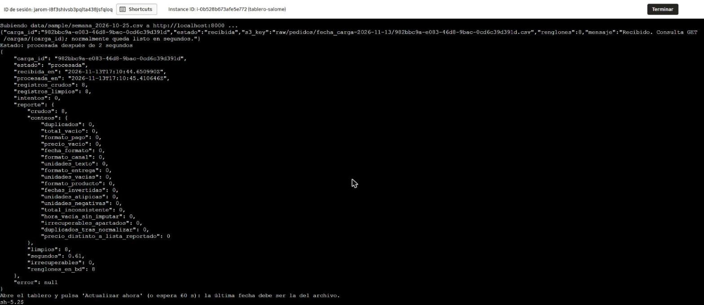

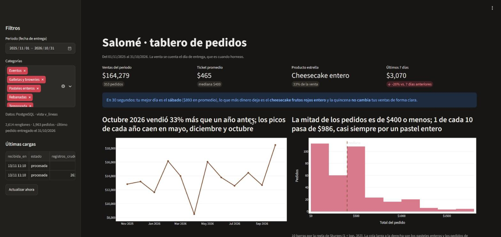

## 7. Limpieza automatizada

`limpieza.py` pasó de script de E1 a módulo con pruebas que corre dentro del worker. Las pruebas están en `tests/` (`python -m pytest tests/`, 34 pruebas):

- Una prueba por regla: duplicados, variantes de nombre, canal abreviado, unidades como texto, fecha día/mes/año, precio vacío con la lista vigente en esa fecha (antes y después del 15 de enero), unidades vacías, negativas, cero de más, pedido de evento que no se debe tocar, total inconsistente, año viejo en enero, fechas al revés, renglón irrecuperable y archivo sin columnas.
- Idempotencia: limpiar un archivo ya limpio no cambia nada.
- Historial completo: se limpia el historial de 2020 a 2026 y el resultado tiene que pasar todas las reglas de `validar_limpio` sin perder ningún pedido.
- Validación de entrada de la API: CSV válido, con BOM de Excel, vacío, sin renglones, sin columnas, renglón cortado, `pedido_id` no numérico, archivo no UTF-8 y nombre de cliente en lugar de código.

## 8. Serie de tiempo

Notebook: `notebooks/E2_series_y_regresion.ipynb`. Serie: venta diaria por fecha de entrega, con cero en los días sin entregas, del 1 de enero de 2022 al 31 de octubre de 2026 (1,765 días). Empezamos en 2022 porque en 2020 y 2021 el negocio estaba arrancando y crecía a otro ritmo. Es una serie con muchos ceros: en cuatro de cada diez días que Salomé abre no se entrega nada.

### Descomposición

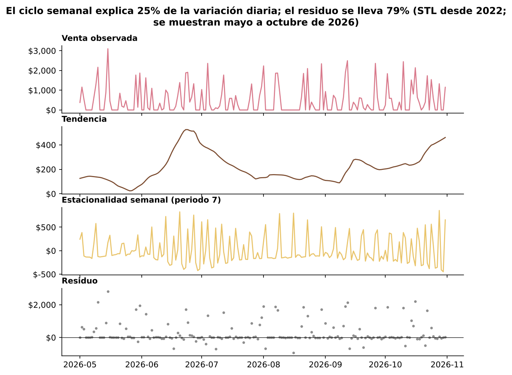

STL con periodo 7 sobre la venta diaria. El componente semanal explica 25% de la varianza de la serie, el residuo 79% y la tendencia 5% (las partes no suman 100% porque los componentes no son independientes). El patrón semanal promedio va de −$232 el lunes a +$293 el sábado respecto a la tendencia. Que el residuo sea tan grande es lo esperable con poco más de un pedido diario: un pastel entero de más o de menos mueve la venta del día más que cualquier patrón.

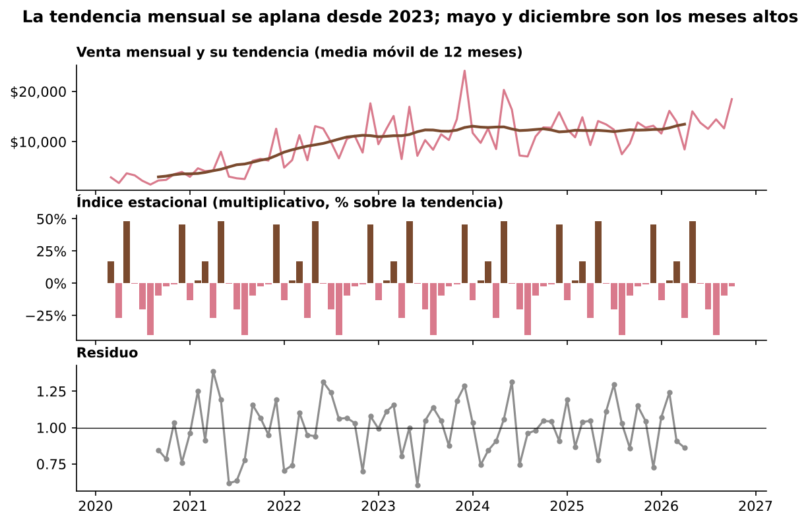

Descomposición multiplicativa de la venta mensual con periodo 12 (marzo de 2020 a octubre de 2026). Índices estacionales: mayo 1.48 y diciembre 1.46 (48% y 46% sobre la tendencia), marzo 1.17; agosto es el mes más bajo con 0.60, cuando coinciden la semana de vacaciones de Salomé y las lluvias, y abril le sigue con 0.73. La tendencia sube hasta 2023 y desde ahí se aplana en unos 12 mil pesos al mes.

### Estacionariedad

Prueba de Dickey-Fuller aumentada; H0: la serie tiene raíz unitaria. Rezagos elegidos por AIC.

| Serie | Estadístico | Crítico 5% | p | ¿Estacionaria? |
|---|---|---|---|---|
| Diaria desde 2022, con constante | −8.55 | −2.86 | < 0.001 | Sí |
| Diaria desde 2022, con constante y tendencia | −8.88 | −3.41 | < 0.001 | Sí |
| Diaria 2020-2026, con constante y tendencia | −7.99 | −3.41 | < 0.001 | Sí |
| Diaria, diferencia de 7 días | −14.12 | −2.86 | < 0.001 | Sí |
| Mensual 2020-2026 | −2.12 | −2.91 | 0.235 | No |
| Mensual, primera diferencia | −4.71 | −2.91 | < 0.001 | Sí |

Interpretación: a escala diaria el ruido domina y la serie regresa rápido a su nivel, así que el ADF rechaza la raíz unitaria aun con el crecimiento de 2020. A escala mensual sí hay raíz unitaria (la subida de 2020 a 2023) y una diferencia la quita. Los modelos autorregresivos necesitan estacionariedad porque estiman una relación fija entre hoy y los días anteriores; si la media se mueve, esa relación cambia con el tiempo. Para el ARIMA diario de E3 esto sugiere d = 0 en la parte no estacional, pero la ACF dice que la parte estacional sí necesita diferenciarse.

### ACF y PACF

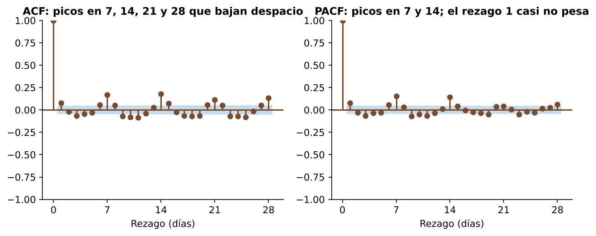

| Rezago | 1 | 2 | 6 | 7 | 8 | 14 | 21 | 28 |
|---|---|---|---|---|---|---|---|---|
| ACF | 0.08 | −0.02 | 0.06 | 0.17 | 0.05 | 0.18 | 0.11 | 0.13 |
| PACF | 0.08 | −0.03 | 0.06 | 0.16 | 0.03 | 0.14 | 0.04 | 0.07 |

La ACF tiene picos en 7, 14, 21 y 28 que bajan despacio: estacionalidad semanal persistente, la señal de que conviene una diferencia estacional (D = 1, s = 7). La autocorrelación de un día al siguiente casi no existe (0.08): vender bien hoy no dice nada de mañana, solo del mismo día de la semana siguiente. La PACF tiene picos en 7 y 14 y luego se apaga, compatible con un AR estacional de orden 1 o 2. Punto de partida para E3: SARIMA(0,0,1)(1,1,1)₇, a comparar por AIC y BIC contra variantes cercanas.

## 9. Regresión lineal por mínimos cuadrados

Implementación propia en `services/tablero/modelos_e2.py` (función `mco`) y en el notebook, con la ecuación normal:

β = (XᵀX)⁻¹ Xᵀ y

- y: venta del día, solo en días que Salomé abrió (con o sin pedidos). Los días cerrados se excluyen porque su venta es cero por decisión de ella, no por falta de demanda; para pronosticar se usa su calendario de cierres.
- X (21 columnas): intercepto, tendencia en años desde 2022, día de la semana (miércoles a domingo; base martes), mes (febrero a diciembre; base enero), quincena, fecha fuerte (14 de febrero, 10 de mayo, 24 y 31 de diciembre, 6 de enero, Día del Padre) y víspera de fecha fuerte. Se deja fuera una categoría de cada grupo para que XᵀX sea invertible; su número de condición es 860, sin problema numérico.
- Entrenamiento: 2022-01-01 a 2025-10-31 (1,144 días abiertos). Prueba: 2025-11-01 a 2026-10-31 (296 días). La partición es cronológica, nunca aleatoria.

Comparación contra scikit-learn (`LinearRegression(fit_intercept=False)` con la misma X): la diferencia máxima entre coeficientes es 2.5 × 10⁻¹² y entre predicciones de prueba 6.2 × 10⁻¹². Son la misma solución hasta el redondeo de punto flotante.

| Conjunto | MSE | RMSE | MAE | R² |
|---|---|---|---|---|
| Entrenamiento (a mano) | 295,094 | $543 | $421 | 0.14 |
| Prueba (a mano) | 479,482 | $692 | $534 | 0.06 |
| Prueba (scikit-learn) | 479,482 | $692 | $534 | 0.06 |
| Prueba, ingenuo estacional (lo mismo que el mismo día de la semana pasada) | 911,219 | $955 | $646 | −0.78 |
| Prueba, con t² (descartado) | 503,605 | $710 | $504 | 0.01 |

Coeficientes principales (pesos por día, con su error estándar de σ̂²(XᵀX)⁻¹):

| Variable | β | Error est. | p |
|---|---|---|---|
| Intercepto (martes de enero de 2022) | 81 | 69 | 0.25 |
| Tendencia (por año) | 36 | 15 | 0.02 |
| Viernes | 270 | 56 | < 0.001 |
| Sábado | 450 | 56 | < 0.001 |
| Domingo | 205 | 56 | < 0.001 |
| Mayo | 209 | 76 | 0.01 |
| Diciembre | 286 | 83 | < 0.001 |
| Fecha fuerte | 987 | 121 | < 0.001 |
| Víspera de fecha fuerte | 290 | 124 | 0.02 |
| Quincena | −53 | 41 | 0.19 |

Lectura para el negocio: un sábado normal vende unos $450 más que un martes; el 10 de mayo o el 24 de diciembre suman casi $1,000 sobre eso. La tendencia agrega $36 por año a un día típico, alrededor de 6% anual, un poco menos que lo que suben los precios (7% en promedio desde 2023). En piezas, el negocio ya no crece.

La quincena sale igual que en E1: no se distingue del azar. En E1 la comparación directa dio +7% con p = 0.41, y aquí el coeficiente es negativo y tampoco significativo. Con estos datos no hay evidencia de que la quincena cambie las ventas de Salomé, así que no la usamos para planear.

Lineal contra cuadrática: probamos agregar t² usando 2025 como validación dentro del entrenamiento. La lineal tuvo menor RMSE (610 contra 619) y mayor R² (0.11 contra 0.08); la cuadrática tuvo menor MAE (450 contra 487). Elegimos por RMSE porque es el criterio que minimizan los mínimos cuadrados. En el año de prueba la decisión se sostiene: la cuadrática se dobla y subestima la venta en $136 por día, mientras que el sesgo de la lineal es de −$4.

### Análisis de residuos

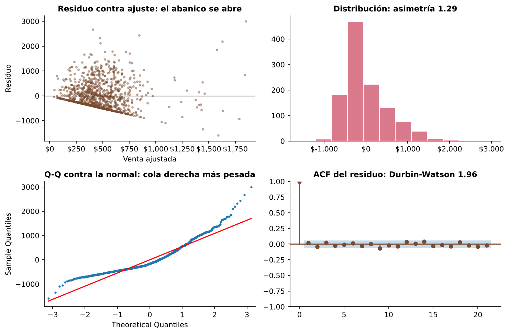

| Supuesto | Prueba | Resultado | Lectura |
|---|---|---|---|
| Media cero | promedio | −9 × 10⁻¹³ | Se cumple por construcción (hay intercepto) |
| Independencia | Durbin-Watson | 1.96; ACF del residuo entre −0.04 y 0.03 en los rezagos 1 a 7 | Sin autocorrelación: el día de la semana ya está en el modelo |
| Varianza constante | Breusch-Pagan | p = 1 × 10⁻¹⁵; corr(\|e\|, ajuste) = 0.33 | No se cumple: el error crece en los días grandes (el abanico de la gráfica) |
| Normalidad | Shapiro-Wilk, Q-Q, asimetría | p = 3 × 10⁻²⁶; asimetría 1.29; curtosis 2.28 | No se cumple: hay muchos días en cero y pocos días muy grandes. Con 1,144 datos los coeficientes siguen siendo insesgados, pero los p valores de la tabla son aproximados |

En la gráfica de residuo contra ajuste se ve una diagonal en la parte de abajo: son los días abiertos sin ningún pedido, donde la venta real es cero y el residuo es exactamente menos lo que el modelo esperaba. Es la huella de una demanda que llega de a un pedido.

R² de 0.06 en prueba significa que la regresión explica muy poco de lo que sube y baja la venta de un día. El modelo no está mal planteado: con poco más de un pedido diario, que entre o no un pastel entero es casi azar, y eso ningún calendario lo predice. Lo que sí captura es la parte predecible (sábados, mayo, diciembre y fechas fuertes), y con eso le gana al ingenuo estacional: su error promedio es 17% menor. Sirve como línea base explicable para comparar contra el SARIMA de E3. Otra idea que queda anotada: modelar piezas por producto con una distribución de conteo (Poisson) en vez de pesos con error normal, que encaja mejor con tantos días en cero.

## 10. Tablero v2

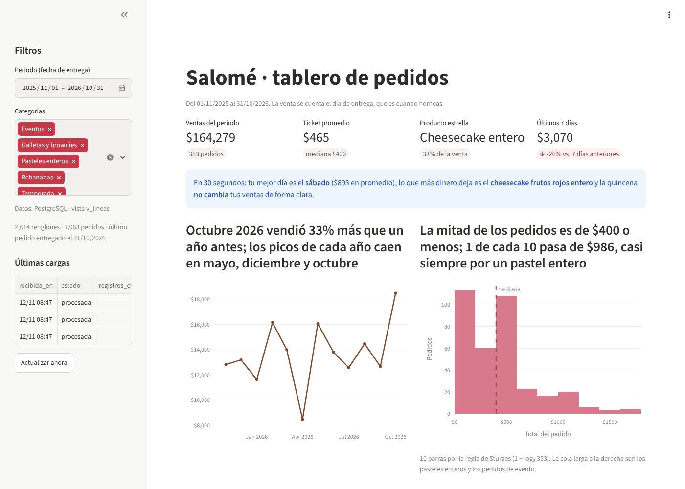

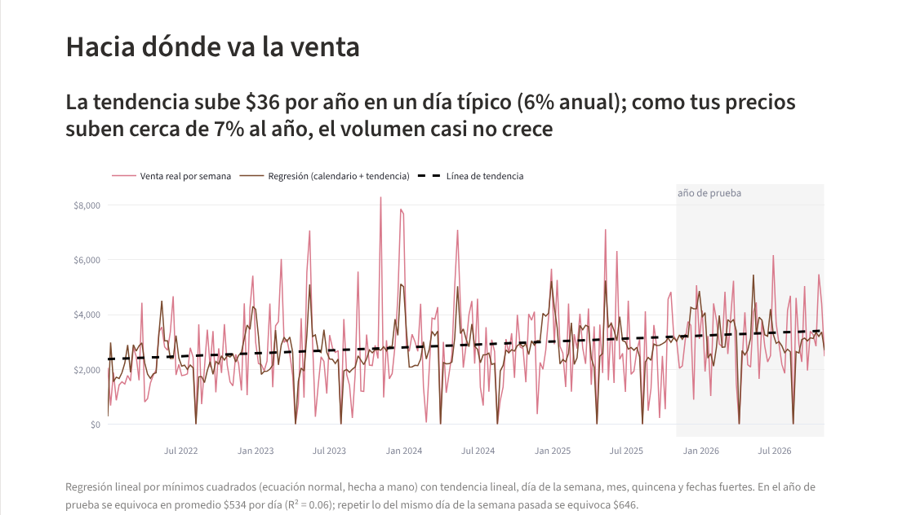

Capturas de nuestra prueba local leyendo de PostgreSQL. Lo nuevo respecto a E1:

- Lee de la vista `v_lineas` de PostgreSQL (`FUENTE=postgres`), con caché de 60 segundos y botón "Actualizar ahora".
- Panel de últimas cargas en la barra lateral, con estado, renglones crudos y limpios y segundos de proceso.
- Sección "Hacia dónde va la venta": venta semanal real, ajuste de la regresión y su línea de tendencia, con el año de prueba sombreado y el error del modelo contra el ingenuo escrito al pie.
- Descomposición STL de los últimos seis meses del periodo elegido (observada, tendencia, estacionalidad semanal y residuo), con el porcentaje de variación que explica la semana en el título.

## 11. Cómo se instala y cuánto cuesta

| Paso | Script |
|---|---|
| Colas, roles, base de datos y reglas de red | `infra/aws/crear_infra_e2.sh` (AWS CLI; en E3 pasa a Terraform) |
| Servicios en la EC2, esquema y usuarios de base | `infra/ec2/instalar_servicios.sh` (por Session Manager) |
| Prueba de privilegios | `infra/aws/probar_privilegios.sh` |
| Prueba local sin nube | `scripts/preparar_local.py` con moto y PostgreSQL local |

Costos: S3 guarda menos de 10 MB; SQS queda dentro del millón de solicitudes gratuitas; la EC2 t3.micro y la RDS db.t4g.micro se cubren con los créditos del Plan gratuito. La alerta de Budgets sigue activa. Cuando no hay revisión, detenemos la EC2 y la RDS (`aws rds stop-db-instance` la apaga hasta 7 días). El cálculo para 1, 10 y 100 negocios con la calculadora de AWS va en E5.

## 12. Uso de IA generativa

Claude (Anthropic) ayudó a escribir la API, el worker, el esquema, las políticas de IAM, los scripts de instalación, las pruebas, el notebook y el borrador de este documento. Ejecutamos y revisamos todo; las decisiones de diseño (orden S3-base-cola, idempotencia, roles separados, lineal en vez de cuadrática) las podemos defender los dos.
