# E3 · Inteligencia en producción: el modelo vive en la nube

Proyecto integrador DATA STARTUP · Cómputo en la Nube (IAD-2408) × Analítica de Datos (IAD-2403) · TecNM Campus Colima

| | |
|---|---|
| Integrantes | Jarom Cortes Pérez (Cloud Lead) · Carlos Antonio Vogel Romero (Data Lead) |
| Repositorio | https://github.com/Vogelito09-lab/data-startup-postreria · etiqueta `e3` |
| Tablero v3 | `https://sa-e7534c88ee9e4a2abb60db3aa642242d.ecs.us-east-2.on.aws` |
| API de modelos | `https://sa-4a340ffb9b624e52980333ab674441b5.ecs.us-east-2.on.aws/docs` |
| API de ingesta | `https://sa-0df9f449806a48c7a39cbc08ef01363c.ecs.us-east-2.on.aws/docs` (pide `X-Api-Key`) |
| Fecha | 19 de noviembre de 2026 |

Las URLs estuvieron activas durante la prueba del 19 de noviembre. Entre revisiones los servicios de ECS se borran para no gastar (FinOps) y se recrean con `python infra/aws/desplegar_ecs.py --version 3`; al recrearlos ECS Express les asigna una dirección nueva.

En E2 los datos ya viajaban solos, pero todo corría en una sola máquina virtual y el pronóstico no existía. En E3 cada servicio es un contenedor, la ingesta, los modelos y el tablero corren en un servicio administrado con autoescalado, el worker se volvió una función que se dispara con cada mensaje, y la infraestructura base se crea y se destruye con Terraform. Del lado de analítica, un SARIMA pronostica la venta de los próximos 7 a 30 días con su banda de confianza y un clasificador avisa con dos días de anticipación si viene un día fuerte. El tablero consume los dos desde la API.

## 1. Arquitectura

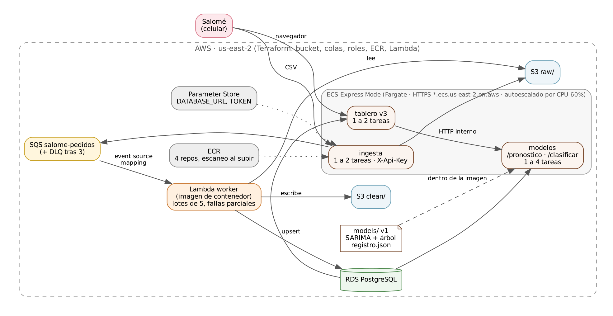

Fuente: `docs/arquitectura_e3.dot`. Lo que cambia contra E2:

| Pieza | E2 | E3 |
|---|---|---|
| Ingesta | Proceso en la EC2 | Contenedor en ECS Express Mode, HTTPS, 1 a 2 tareas, llave `X-Api-Key` |
| Worker | Proceso en la EC2 haciendo long polling | Lambda con imagen de contenedor, disparada por la cola |
| Modelos | No existía | Contenedor en ECS Express Mode, 1 a 4 tareas |
| Tablero | Streamlit en la EC2 | Contenedor en ECS Express Mode, consume la API de modelos |
| Infraestructura | Scripts de AWS CLI | Terraform (bucket, colas, roles, ECR, Lambda, endpoint de S3) |
| Secretos | `/etc/salome/*.env` en la EC2 | Parameter Store (SecureString) inyectado por ECS |

La EC2 de E2 se queda encendida solo hasta confirmar que ECS funciona; después se detiene.

## 2. Contenedores

Un Dockerfile por servicio, todos construidos desde la raíz del repositorio:

| Imagen | Archivo | Base | Qué copia |
|---|---|---|---|
| `salome-ingesta` | `services/ingesta/Dockerfile` | python:3.13-slim | `app.py` |
| `salome-modelos` | `services/modelos/Dockerfile` | python:3.13-slim | API, `nucleo.py`, `analitica.py`, `fuente.py`, calendario y `models/` |
| `salome-tablero` | `services/tablero/Dockerfile` | python:3.13-slim | Streamlit y sus módulos |
| `salome-worker` | `services/worker/Dockerfile` | python:3.13-slim | Worker de ciclo (solo para `docker compose`) |
| `salome-worker-lambda` | `services/worker/Dockerfile.lambda` | public.ecr.aws/lambda/python:3.13 | Worker más `lambda_handler.py` |

Las cuatro imágenes de servicio son multi-stage: la primera etapa instala las dependencias en `/instalado` y la segunda copia solo ese resultado y el código, sin caché de pip ni herramientas de compilación. Corren con un usuario sin privilegios (uid 10001), las tres que exponen un puerto tienen `HEALTHCHECK` contra su ruta de salud y ninguna lleva secretos: las cadenas de conexión llegan como variables de entorno al arrancar. Cada servicio tiene su propio `requirements.txt` con lo mínimo que usa, fijado a las mismas versiones con las que se entrenaron los modelos (scikit-learn 1.9.1, statsmodels 0.15.0), porque un árbol entrenado con una versión no se garantiza al cargarlo con otra. `.dockerignore` deja fuera datos, documentos, notebooks y pruebas.

Imagen contra contenedor: la imagen es la plantilla de solo lectura, hecha de capas (sistema base, dependencias, código); el contenedor es una instancia en ejecución de esa imagen con su propia capa de escritura. Como las capas de dependencias casi no cambian, al modificar el código solo se reconstruye la última. Un contenedor arranca en segundos porque comparte el kernel de la máquina y solo inicia un proceso; una VM tiene que arrancar un sistema operativo completo y tarda minutos.

Todo el sistema en local con un comando:

```
docker compose up --build
```

`docker-compose.yml` levanta siete servicios: PostgreSQL 16, moto (S3 y SQS emulados), un contenedor `init` que crea el bucket, las colas, el esquema y los tres usuarios de base, y después ingesta, worker, modelos y tablero. Tablero en `localhost:8501`, ingesta en `localhost:8000/docs`, modelos en `localhost:8100/docs`. El archivo se validó con `docker compose config`.

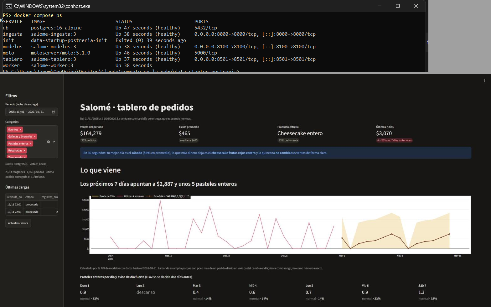

## 3. Despliegue administrado: ECS Express Mode

App Runner, la opción que sugería el proyecto, ya no acepta clientes nuevos; AWS recomienda Amazon ECS Express Mode. Con una sola llamada crea el servicio en Fargate, un balanceador con HTTPS en `https://<servicio>.ecs.us-east-2.on.aws`, la revisión de salud y el autoescalado. Lo desplegamos con `infra/aws/desplegar_ecs.py`, que arma los parámetros con las salidas de Terraform y crea o actualiza los tres servicios. Los parámetros se validan contra el modelo de la API de AWS antes de llamarla (`--validar`).

| Servicio | CPU / memoria por tarea | Tareas mín. a máx. | Escala con | Salud |
|---|---|---|---|---|
| ingesta | 0.25 vCPU / 512 MiB | 1 a 2 | CPU promedio 60% | `/salud` |
| modelos | 0.5 vCPU / 1 GiB | 1 a 4 | CPU promedio 60% | `/salud` |
| tablero | 0.5 vCPU / 1 GiB | 1 a 2 | CPU promedio 60% | `/_stcore/health` |

Secretos: cada servicio recibe `DATABASE_URL` desde Parameter Store (`/salome/<servicio>/DATABASE_URL`, tipo SecureString, nivel estándar sin costo). El rol de ejecución de ECS solo puede leer parámetros bajo `/salome/` y descifrarlos a través de SSM. Como la ingesta ahora tiene URL pública, desde E3 exige el encabezado `X-Api-Key` con una llave que también vive en Parameter Store; sin ella responde 401 (prueba `test_llave_obligatoria_cuando_hay_token`). El límite de peticiones por cliente llega en E4.

Red: Terraform crea el grupo de seguridad `salome-ecs-tareas` y le abre el 5432 de la RDS. La base sigue sin IP pública.

Despliegue del 19 de noviembre: los tres servicios quedaron `ACTIVE` con HTTPS y revisión de salud en verde unos dos minutos después de crearlos. La ingesta responde 401 a una carga sin `X-Api-Key` y 202 con ella. El tablero, desde su URL pública, muestra la sección "Lo que viene" con el pronóstico que calcula la API de modelos en ECS.

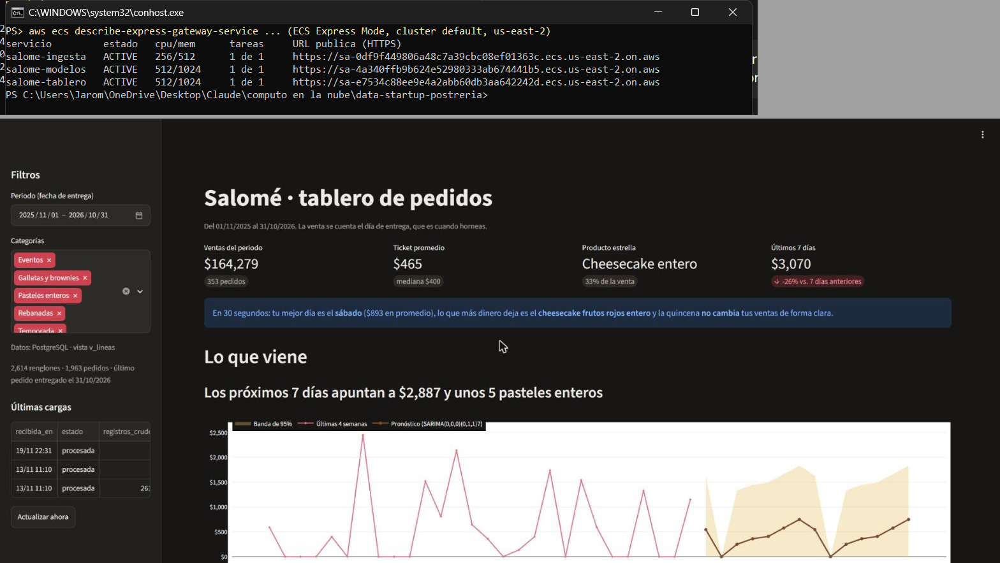

## 4. Orquestación con Kubernetes

Manifiestos en `k8s/`, probados contra el esquema oficial de Kubernetes 1.30 con `kubernetes-validate --strict`. El clúster es local con kind para no gastar (`k8s/levantar_kind.sh` construye las imágenes, crea el clúster, instala metrics-server y aplica todo).

| Archivo | Objetos |
|---|---|
| `00-namespace.yaml` | Namespace `salome` |
| `01-config.yaml` | ConfigMap con la fuente de datos y la URL de modelos |
| `10-modelos.yaml` | Deployment, Service (NodePort 30100) y HorizontalPodAutoscaler de 1 a 5 réplicas al 60% de CPU |
| `20-tablero.yaml` | Deployment, Service (NodePort 30501) y HPA de 1 a 3 réplicas al 70% de CPU |

Cómo encajan: un pod es la unidad mínima, uno o más contenedores que comparten red. El Deployment declara cuántas réplicas del pod deben existir y las reemplaza si una muere o falla su `livenessProbe`; la `readinessProbe` evita mandarle tráfico a una réplica que todavía está cargando los modelos. El Service da un nombre fijo (`modelos:8100`) y reparte el tráfico entre las réplicas listas, así el tablero no necesita saber cuántas hay. El HPA mide el CPU de cada pod contra lo que pidió (`requests.cpu: 250m`) y agrega réplicas cuando el promedio pasa de 60%; para quitarlas espera 120 segundos de calma, para no subir y bajar a cada rato. Los pods corren sin root, sin escalar privilegios y con el sistema de archivos de solo lectura (con `/tmp` aparte).

Prueba en kind con 50 usuarios y la caché apagada: el CPU llegó a 400% de lo pedido y el HPA pasó de 1 a 5 réplicas en un minuto; con cinco réplicas el promedio bajó a 82%. En el primer intento el pod se reiniciaba por falta de memoria (`OOMKilled` con 768 MiB) y por fallar la revisión de vida mientras estaba ocupado; subimos el límite a 1.5 GiB y el tiempo de espera de las sondas, y con eso el escalado fue limpio.

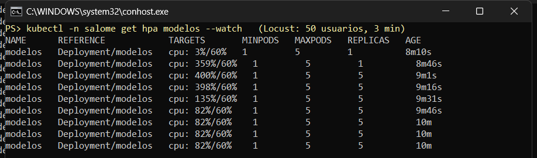

## 5. Serverless: el worker como Lambda

`services/worker/lambda_handler.py` reutiliza el mismo `procesar()` de E2. La cola dispara la función con un event source mapping (lotes de hasta 5 mensajes, ventana de 5 segundos, concurrencia máxima 2 para no saturar la base). Si un mensaje falla, la función lo devuelve en `batchItemFailures` y solo ese regresa a la cola; los demás del lote no se repiten. A los 3 intentos SQS lo manda a la DLQ, igual que en E2. El tiempo de visibilidad de la cola sube a 360 segundos, seis veces el límite de la Lambda (60 s), como recomienda AWS.

La función se empaqueta como imagen de contenedor porque pandas y numpy no caben cómodos en un zip de 250 MB. Vive en la VPC para llegar a la RDS; para leer y escribir S3 sin NAT (que cobra por hora) Terraform agrega un endpoint de S3 tipo gateway, que no cuesta. El cliente de S3, el catálogo de precios y la conexión a la base se crean fuera del handler, así que solo la primera invocación de cada contenedor paga el arranque en frío.

Prueba `tests/test_lambda.py` (con S3 emulado y PostgreSQL real): un lote con un mensaje bueno y uno que apunta a un archivo inexistente devuelve solo el malo en `batchItemFailures`; la base queda con una carga `procesada` y otra en `error`, y `clean/` tiene el consolidado.

Lo que se gana y se pierde: se paga por ejecución (unas cuantas cargas al día cuestan prácticamente cero) y no hay que vigilar un proceso; a cambio hay arranque en frío de unos segundos, límite de 15 minutos por invocación y una conexión a base por contenedor, que con muchas cargas simultáneas pediría RDS Proxy.

En la nube: la semana del 25 al 31 de octubre subida a la ingesta de ECS quedó `procesada` 40 segundos después, sin que nadie tocara nada. Casi todo ese tiempo fue el arranque en frío: la fase de inicio (importar pandas y abrir la conexión) pasó del límite de 10 segundos y Lambda la repitió dentro de la misma invocación; la limpieza y la escritura tardaron 1.35 s y la función usó 175 MB de 1,024. Las siguientes invocaciones del mismo contenedor ya no pagan ese arranque.

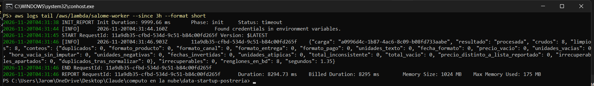

## 6. Autoescalado y prueba de carga

`tests/locustfile.py` simula a 50 personas abriendo el tablero al mismo tiempo: cada una pide el pronóstico de venta, el de pasteles enteros y la clasificación de algún día de la semana, con 1 a 3 segundos entre clics. Primero medimos en una máquina la API de modelos con 1, 2 y 4 procesos de uvicorn, que es lo que hace el autoescalado al agregar copias. Las corridas sin caché se hicieron antes de agregarla; la última, con la caché que ya trae la API. Archivos crudos en `docs/carga/`.

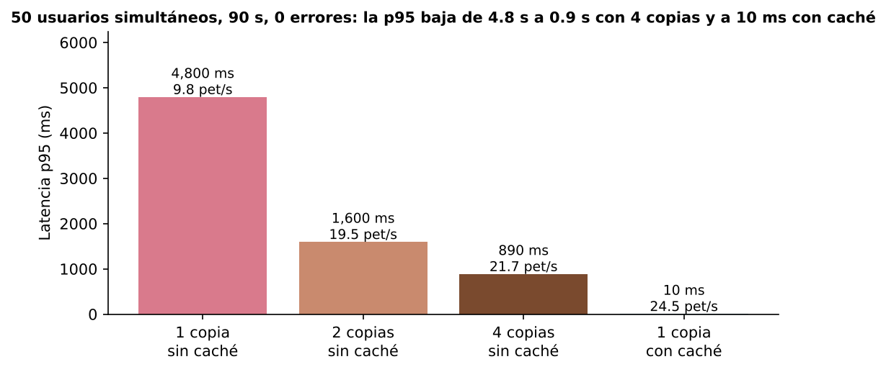

| Configuración | Peticiones | Errores | Mediana | p95 | p99 | Peticiones/s |
|---|---|---|---|---|---|---|
| 1 copia, sin caché | 874 | 0 | 3,400 ms | 4,800 ms | 5,400 ms | 9.8 |
| 2 copias, sin caché | 1,738 | 0 | 320 ms | 1,600 ms | 2,200 ms | 19.5 |
| 4 copias, sin caché | 1,934 | 0 | 220 ms | 890 ms | 1,300 ms | 21.7 |
| 1 copia, con caché | 2,183 | 0 | 4 ms | 10 ms | 120 ms | 24.5 |

Análisis: con una sola copia el servicio no se cae (cero errores), pero las peticiones hacen fila y la p95 llega a casi 5 segundos, porque cada pronóstico corre el filtro de Kalman sobre 1,765 días. Duplicar las copias divide la espera más de la mitad, y con cuatro la p95 baja de un segundo. De dos a cuatro copias las peticiones por segundo apenas suben porque ya se atiende casi todo lo que piden 50 usuarios con esas pausas (unas 25 por segundo). La mejora más grande vino de dejar de repetir trabajo: el pronóstico solo cambia cuando llegan pedidos, así que la API lo guarda por versión de datos y lo recalcula cuando cambia el último pedido. Con eso una sola copia responde en 10 ms. El autoescalado queda como respaldo para picos o para cuando se borre la caché.

Configuración en la nube: modelos escala de 1 a 4 tareas en ECS (de 1 a 5 réplicas en Kubernetes) cuando el CPU promedio pasa de 60%. Para la prueba en la nube se corre lo mismo contra la URL pública:

```
locust -f tests/locustfile.py --host https://sa-4a340ffb9b624e52980333ab674441b5.ecs.us-east-2.on.aws --headless -u 50 -r 5 -t 8m --csv docs/carga/ecs
```

Para forzar trabajo se apagó la caché (`CACHE_PRONOSTICO=0`) durante la prueba. Resultado del 19 de noviembre (`docs/carga/ecs_stats.csv`):

| Configuración | Peticiones | Errores | Mediana | p95 | p99 | Peticiones/s | Tareas |
|---|---|---|---|---|---|---|---|
| ECS, 1 tarea de 0.5 vCPU, sin caché, 8 min | 1,328 | 250 (19%) | 14,000 ms | 35,000 ms | 47,000 ms | 2.8 | 1 (nunca escaló) |

Análisis honesto: el autoescalado **no** se disparó. CloudWatch muestra el CPU de la tarea con máximos de 100% cada minuto, pero el promedio por minuto se quedó en 50%, por debajo del objetivo de 60%, así que la política de seguimiento nunca pidió otra tarea. La causa es que cada petición ocupa un solo núcleo (Python con su candado global) y la tarea pasa ratos esperando a la base, de modo que el promedio no refleja la saturación que sí sienten los usuarios: la p95 llegó a 35 segundos. Los 250 errores fueron 502 del balanceador: la tarea saturada no contestó a tiempo su revisión de salud, ECS la reemplazó y mientras arrancaba la nueva no había a quién mandar el tráfico. Comparado con la prueba local, una tarea de 0.5 vCPU en Fargate rinde mucho menos que un núcleo completo de la computadora.

Qué cambiamos a partir de esto: (1) en producción la caché queda encendida, que es lo que resuelve el problema de fondo (10 ms con una sola copia en la prueba local); (2) para E4 el objetivo de CPU de modelos baja de 60% a 40% y el mínimo sube a 2 tareas en horario de pedidos, para que una tarea saturada no deje el servicio sin respaldo mientras se reemplaza; (3) la revisión de salud de modelos debe responder sin pasar por el modelo. En Kubernetes, donde el HPA mide contra lo pedido (250m) y no contra el total de la tarea, el escalado sí se vio (sección 4).

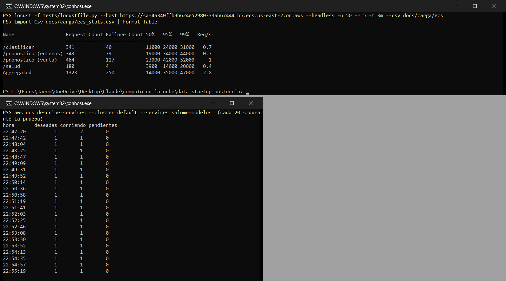

## 7. Infraestructura como código

`infra/terraform/` crea con AWS como proveedor:

| Archivo | Recursos |
|---|---|
| `s3.tf` | Bucket del data lake con acceso público bloqueado, cifrado, versionado, regla para borrar versiones viejas de `clean/` a los 30 días y endpoint de S3 para la VPC (solo junto con la Lambda) |
| `sqs.tf` | Cola principal (visibilidad 360 s, long polling 20 s, cifrado) y DLQ con `maxReceiveCount = 3` |
| `iam.tf` | Roles de E2 (base de la EC2 y uno por servicio), rol de la Lambda, roles de ejecución, de infraestructura y de tarea para ECS; cada política nombra solo sus prefijos y su cola |
| `ecr.tf` | Cuatro repositorios con etiquetas inmutables, escaneo al subir y límite de 5 imágenes |
| `lambda.tf` | Grupos de seguridad, regla de entrada en la RDS, función del worker y su event source mapping |
| `ecs.tf` | Grupos de bitácoras de los tres servicios de ECS, con 14 días de retención |

Hay dos entornos. `prueba` crea copias con sufijo `-prueba` que se pueden destruir con todo y archivos; `prod` usa los nombres reales y primero importa lo que E1 y E2 crearon a mano (`importar_prod.sh`), para no duplicarlo ni borrarlo. La prueba de fuego se hace en `prueba`:

```
terraform -chdir=infra/terraform init
terraform -chdir=infra/terraform workspace new prueba
terraform -chdir=infra/terraform apply -var-file=prueba.tfvars      # crea
terraform -chdir=infra/terraform destroy -var-file=prueba.tfvars    # destruye todo
terraform -chdir=infra/terraform apply -var-file=prueba.tfvars      # lo recrea idéntico
```

Resultado del 19 de noviembre en el entorno `prueba`: `destroy` borró 44 recursos y el `apply` siguiente los recreó idénticos (44 agregados, 0 cambiados). Después se destruyó otra vez para no dejar la copia. En `prod`, `importar_prod.sh` trajo a Terraform los 15 recursos que E1 y E2 crearon a mano y el plan no borró nada (31 agregados, 10 actualizados en su lugar, 0 destruidos).

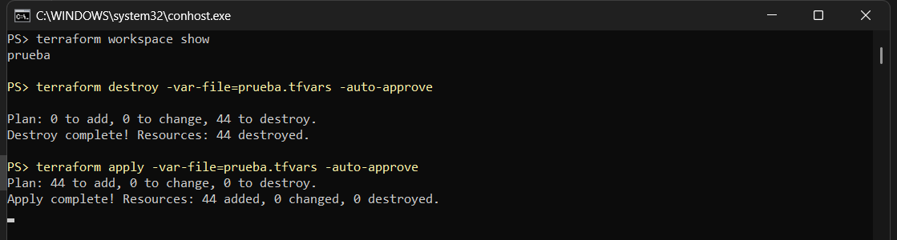

Declarativo contra imperativo: el script de E2 decía qué pasos ejecutar ("crea la cola, luego el rol"); si se corría dos veces fallaba porque la cola ya existía. Terraform describe cómo debe quedar la infraestructura y calcula los pasos comparando contra su estado (`terraform.tfstate`), así que aplicar dos veces el mismo código no cambia nada la segunda vez: es idempotente. El estado guarda los identificadores reales y puede contener datos sensibles, por eso no se sube al repositorio. La cadena de conexión de la Lambda entra como `TF_VAR_database_url` y la variable está marcada como sensible. El archivo de HCL se revisó con un parser de HCL2; `terraform validate` y `plan` se corren al conectar la cuenta.

## 8. Cómputo para entrenar: CPU o GPU

Todo el entrenamiento corre en CPU y así debe seguir. La búsqueda completa de órdenes del SARIMA (72 modelos ajustados por máxima verosimilitud sobre 1,400 días) tardó 40 segundos en una computadora sin GPU; los cuatro clasificadores con validación cruzada y búsqueda de hiperparámetros, menos de 3 segundos juntos; el reentrenamiento final de los tres artefactos con toda la historia, 0.8 segundos. Una GPU acelera operaciones con matrices grandes en paralelo, como las de una red neuronal con millones de parámetros. Un SARIMA es un filtro de Kalman secuencial (cada día depende del anterior) con dos parámetros, y un árbol de decisión hace comparaciones sobre unas mil filas; ninguno de los dos se puede repartir en miles de núcleos, y el tiempo de copiar datos a la GPU sería mayor que el cálculo. Rentar una instancia con GPU costaría dólares por hora para ahorrar segundos. La pregunta vuelve en E4 con la LSTM: con unas 1,700 observaciones y una red de una capa, también entrena en CPU en menos de un minuto.

Los modelos se guardan versionados en `models/`: `sarima_venta_v1.pkl`, `sarima_enteros_v1.pkl` y `clasificador_dia_fuerte_v1.pkl`, más `registro.json` con la fecha de entrenamiento, la huella SHA-256 de los datos y de cada artefacto, los parámetros y las métricas de prueba. Del SARIMA solo se guarda la especificación y los dos parámetros estimados (150 bytes): la API los aplica con el filtro de Kalman a los datos más recientes, así el pronóstico siempre parte del último pedido sin reentrenar. La próxima versión se guarda como `_v2` sin borrar la anterior, para poder regresar.

## 9. SARIMA

Script: `scripts/entrenar_e3.py`. Notebook: `notebooks/E3_sarima_y_clasificador.ipynb`.

Serie: venta diaria por día de entrega desde 2022 (1,765 días). Los lunes se dejan en cero porque son parte del patrón semanal; los otros cierres (vacaciones, días sueltos, 81 días) se dejan como faltantes, porque ese cero no es demanda y SARIMAX los salta con el filtro de Kalman. Entrenamiento hasta el 31 de octubre de 2025; el año siguiente es la prueba.

### Cómo se eligieron p, d y q

- d = 0: en E2 el ADF rechazó la raíz unitaria en la serie diaria (estadístico −8.55 contra −2.86).
- D = 1 con s = 7: la ACF de E2 tenía picos en 7, 14, 21 y 28 que bajaban despacio. En la búsqueda, el mejor modelo sin diferencia estacional, SARIMA(0,0,1)(1,0,1)₇, tiene un AIC 89 puntos peor que el mejor con ella.
- p y q pequeños: la ACF y la PACF en el rezago 1 eran de 0.08, casi nada de memoria de un día al siguiente.

Búsqueda: p, q ∈ {0, 1, 2}, P, D, Q ∈ {0, 1}, s = 7, en total 72 modelos. Los mejores:

| Modelo | AIC | BIC | Parámetros |
|---|---|---|---|
| SARIMA(1,0,2)(1,1,1)₇ | 20,508.6 | 20,540.0 | 6 |
| SARIMA(1,0,2)(0,1,1)₇ | 20,512.2 | 20,538.4 | 5 |
| SARIMA(1,0,0)(1,1,1)₇ | 20,512.9 | 20,533.9 | 4 |
| SARIMA(0,0,1)(1,1,1)₇ | 20,513.1 | 20,534.0 | 4 |
| SARIMA(0,0,0)(0,1,1)₇ | 20,517.3 | 20,527.8 | 2 |

El AIC prefiere el modelo de seis parámetros; el BIC, que castiga más cada parámetro extra, prefiere SARIMA(0,0,0)(0,1,1)₇ con solo dos. Elegimos por BIC antes de mirar el año de prueba, y la prueba confirmó que los parámetros extra no ayudan.

### Evaluación con origen móvil

Cada siete días del año de prueba, a partir del sábado 1 de noviembre de 2025, se pronostican los 7 días siguientes usando solo lo que se sabía hasta ese momento (los parámetros quedan fijos y se actualiza el estado del filtro). Todas las métricas son sobre los mismos 295 días abiertos.

| Modelo | MAE | RMSE | Días reales dentro de la banda de 95% |
|---|---|---|---|
| SARIMA(1,0,2)(1,1,1)₇ | $500 | $682 | 88% |
| SARIMA(1,0,2)(0,1,1)₇ | $499 | $681 | 88% |
| SARIMA(1,0,0)(1,1,1)₇ | $501 | $683 | 89% |
| SARIMA(0,0,0)(0,1,1)₇, elegido | $498 | $682 | 88% |
| Promedio por día de la semana | $500 | $685 | — |
| Regresión de E2 | $534 | $692 | — |
| Ingenuo estacional (mismo día de la semana pasada) | $646 | $955 | — |

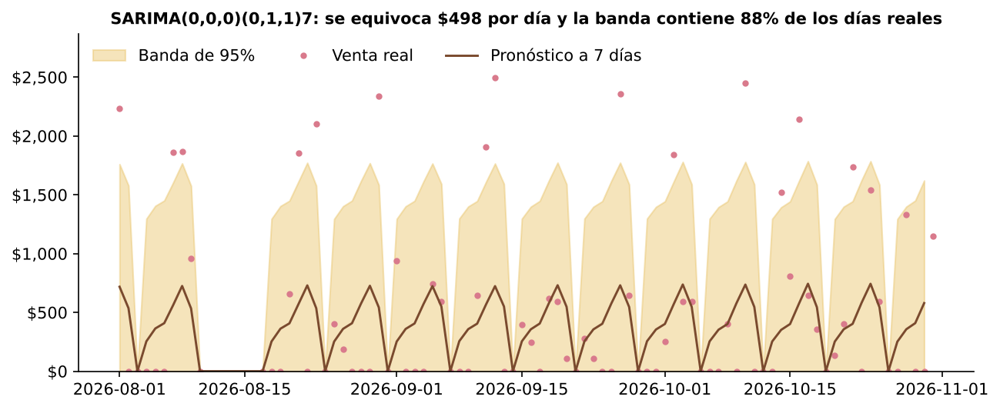

El modelo elegido se equivoca 23% menos que el ingenuo estacional y 7% menos que la regresión de E2. Su único coeficiente, el MA estacional, vale −0.9997 (error estándar 0.21). Ese valor casi cancela la diferencia estacional, lo que en la práctica deja un promedio estable por día de la semana: por eso empata con el promedio simple. Eso también es un hallazgo: con poco más de un pedido diario la venta de hoy no dice nada sobre mañana, y lo único predecible es el día de la semana. La prueba de Ljung-Box sobre los residuos no encuentra autocorrelación pendiente (p = 0.31 a 7 rezagos y 0.60 a 14).

La banda de 95% contiene 88% de los días reales, menos de lo prometido. La razón es la misma que vimos en los residuos de E2: la venta no es normal, tiene muchos ceros y algunos días muy grandes. La banda sirve como rango aproximado; en E4 la vamos a calibrar con el backtesting.

Pasteles enteros: el mismo modelo aplicado a las piezas que Salomé hornea se equivoca 0.89 pasteles por día en promedio contra 1.06 del ingenuo (16% menos), con la misma cobertura de 88%. Es el número que aparece en el tablero para cada día de la semana.

## 10. Clasificador: ¿viene un día fuerte?

Pregunta: ¿ese día se van a entregar 2 o más pasteles enteros? Se decide dos días antes, porque el cheesecake reposa una noche y el queso crema se compra un día antes. Un día fuerte es 22% de los días abiertos, tanto en entrenamiento (1,139 días) como en prueba (296).

Variables, todas conocidas dos días antes al cierre del día: pasteles enteros ya apartados para esa fecha, pedidos ya apartados de cualquier producto, pasteles enteros del mismo día de la semana anterior, promedio de los 28 días previos, fecha fuerte, víspera, quincena, diciembre, mayo y día de la semana.

Criterio: dejar pasar un día fuerte cuesta pedidos rechazados (unos $500 cada uno); preparar una base de más cuesta unos $150 de insumos que se pueden vender en rebanadas. Por eso importa más el recall que la precisión, y usamos F2, que pesa el recall el doble. Lo decidimos antes de ver el año de prueba. Los hiperparámetros se eligieron con validación cruzada temporal de 5 bloques (`TimeSeriesSplit`), sin revolver el orden de los días.

| Modelo | F2 en validación | Precisión | Recall | F1 | F2 | AUC |
|---|---|---|---|---|---|---|
| Naive Bayes | 0.66 | 0.61 | 0.73 | 0.67 | 0.71 | 0.85 |
| SVM (RBF, C = 0.3) | 0.68 | 0.60 | 0.78 | 0.68 | 0.74 | 0.85 |
| KNN (k = 5, por distancia) | 0.53 | 0.70 | 0.63 | 0.66 | 0.64 | 0.80 |
| Árbol de decisión (profundidad 2), elegido | 0.69 | 0.63 | 0.78 | 0.69 | 0.74 | 0.87 |
| Regla simple: 1 pastel entero apartado de viernes a domingo, o 2 en cualquier día | — | 0.69 | 0.73 | 0.71 | 0.73 | — |

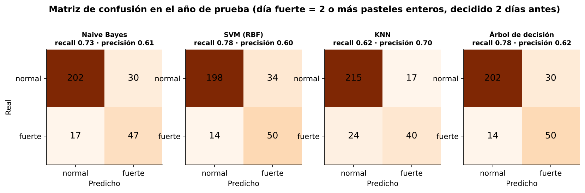

El árbol ganó en validación y también en prueba por F2 (0.744 contra 0.735 del SVM): de 64 días fuertes detectó 50 y se le pasaron 14; a cambio dio 30 falsas alarmas en 232 días normales. Sus reglas caben en una línea: si dos días antes ya hay al menos un pedido apartado para esa fecha, va a ser día fuerte. Toda la información útil está en lo que ya está apartado; el calendario agrega poco.

Hay que decirlo claro: la regla simple que Salomé podría aplicar de memoria tiene mejor F1 (0.71 contra 0.69) y casi el mismo F2. El modelo gana porque detecta tres días fuertes más a cambio de nueve falsas alarmas, que es justo el intercambio que dijimos preferir. La ventaja real de tenerlo en la API es que el aviso llega solo y se recalcula con cada pedido nuevo, sin que ella tenga que revisar sus chats.

Sesgo y varianza: KNN con k = 5 memoriza vecinos y es el que peor generaliza (F2 de 0.53 en validación); el árbol de profundidad 2 es tan simple que casi no puede sobreajustarse, y por eso su validación y su prueba se parecen.

## 11. API de modelos y tablero v3

`services/modelos/app.py`, documentación OpenAPI en `/docs` y en `docs/openapi-modelos.json`.

| Endpoint | Qué devuelve |
|---|---|
| `GET /pronostico?dias=14&serie=venta` | Pronóstico de 1 a 30 días con límites de 95%; cero en días de descanso; `serie=enteros` para pasteles |
| `GET /clasificar?fecha=AAAA-MM-DD` | Día fuerte sí o no, probabilidad, lo apartado y cuándo hay que decidir |
| `GET /modelo` | El contenido de `registro.json` |
| `GET /salud` | Revisión de vida para ECS y Kubernetes |

La API lee los pedidos de la misma fuente que el tablero (PostgreSQL en la nube), con caché de 60 segundos, y guarda cada respuesta hasta que cambian los datos. Pruebas en `tests/test_modelos_api.py`: límites de días, banda ordenada, cero en descanso, fechas fuera de rango y lunes cerrado.

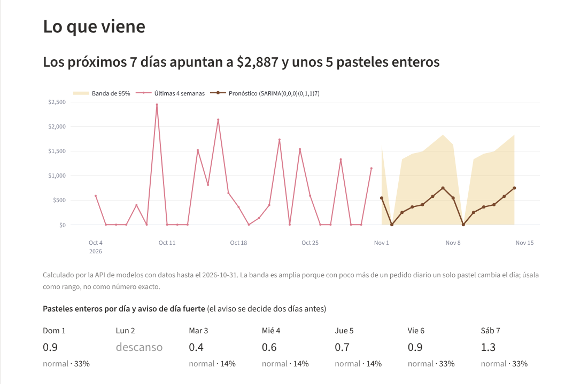

El tablero v3 agrega la sección "Lo que viene": las últimas cuatro semanas, el pronóstico de 14 días con su banda, el total esperado de la semana en pesos y en pasteles, y una tarjeta por día con los pasteles esperados y el aviso de día fuerte. Si la API no responde, el resto del tablero sigue funcionando y lo dice. Captura de nuestra prueba local; los datos terminan el 31 de octubre, así que todavía no hay pedidos apartados para noviembre y todos los días salen normales.

## 12. Pruebas

`python -m pytest tests/`: 44 pruebas, incluidas las de E2. La de la Lambda necesita `TEST_DATABASE_URL` apuntando a un PostgreSQL de prueba.

## 13. Costos

Con los créditos del Plan gratuito: ECS Express cobra Fargate por tarea encendida y el balanceador por hora; con una tarea mínima por servicio es el componente más caro del proyecto, así que entre revisiones se baja el mínimo a cero o se borran los servicios y se recrean con el script. Lambda, SQS, el endpoint de S3, Parameter Store estándar y ECR con cinco imágenes por repositorio quedan en cero o en centavos. El cálculo con la calculadora de AWS para 1, 10 y 100 negocios va en E5.

## 14. Uso de IA generativa

Claude (Anthropic) ayudó con los Dockerfiles, el compose, los manifiestos, Terraform, el script de ECS, la Lambda, la API de modelos, el entrenamiento, las pruebas y el borrador de este documento. Las decisiones (BIC sobre AIC, F2 como criterio, dos días de anticipación, caché por versión de datos, ECS Express en lugar de App Runner) las tomamos y las podemos defender los dos.
